# Kratos — the complete guide

This is the long, friendly version. If you've never used a tool like this, start
at the top and go in order. If you just want a reminder of one thing, jump to it:

1. [What Kratos is, in one minute](#what-kratos-is-in-one-minute)
2. [What you need before you start](#what-you-need-before-you-start)
3. [Installing Kratos](#installing-kratos)
4. [Connecting it to a model](#connecting-it-to-a-model)
5. [The first launch](#the-first-launch)
6. [Connecting a machine to watch](#connecting-a-machine-to-watch)
7. [Your first investigation](#your-first-investigation)
8. [Understanding findings](#understanding-findings)
9. [Keeping track of findings](#keeping-track-of-findings)
10. [Reading more of a machine's logs](#reading-more-of-a-machines-logs)
11. [Detecting log tampering](#detecting-log-tampering)
12. [Sealing a machine's logs](#sealing-a-machines-logs)
13. [When Kratos asks you a question](#when-kratos-asks-you-a-question)
14. [When Kratos asks permission](#when-kratos-asks-permission)
15. [What the model sees](#what-the-model-sees)
16. [Two ways to analyze](#two-ways-to-analyze)
17. [The commands](#the-commands)
18. [Questions about time](#questions-about-time)
19. [Machines you reach through a sub-agent](#machines-you-reach-through-a-sub-agent)
20. [Building a new tool with /evolve](#building-a-new-tool-with-evolve)
21. [Saving and repeating work](#saving-and-repeating-work)
22. [Keeping model costs under control](#keeping-model-costs-under-control)
23. [Keeping an eye on things](#keeping-an-eye-on-things)
24. [Using Kratos from the command line and other tools](#using-kratos-from-the-command-line-and-other-tools)
25. [Using Kratos from a chat app](#using-kratos-from-a-chat-app)
26. [The experimental fix channel](#the-experimental-fix-channel)
27. [Making it yours](#making-it-yours)
28. [When something goes wrong](#when-something-goes-wrong)
29. [Words you'll see](#words-youll-see)

---

## What Kratos is, in one minute

Kratos is a program you talk to. You point it at a computer — a server, a home
lab box, your own laptop — and ask it questions about that computer's security in
plain words. It goes and looks (at the logs, the open network ports, the running
programs, files that changed), works out what's going on, and tells you in a way
you can actually read. If it finds a problem, it tells you how to fix it.

The one thing to hold onto: **by default, Kratos observes and recommends — it
doesn't change the machine itself.** It reads and it advises; whether you act on
the advice is up to you. (There is one experimental, off-by-default exception — see
[The experimental fix channel](#the-experimental-fix-channel) — which you'll never
hit by accident.)

You don't need to know the names of any security tools. You describe what you
care about ("has anyone been trying to break in?") and Kratos figures out which
checks to run.

---

## What you need before you start

Three things:

- **A computer to run Kratos on.** Any recent Linux machine works. You'll use a
  terminal (the black text window). Kratos itself is light.
- **A machine you want to watch, and a way to reach it.** This can be the same
  computer Kratos runs on, another server, or a box on your network. Usually that's
  SSH with a key (the standard passwordless way to log into a server — Kratos can
  create the key for you). For a box you can't reach over SSH, a small agent you
  install on it can connect to Kratos instead.
- **A model for Kratos to think with.** By default this is a hosted AI model you
  reach with an API key (quick to set up). If you'd rather nothing leaves your own
  hardware, you can run a model yourself instead. Both are covered below.

---

## Installing Kratos

You need Python 3.10 or newer. In a terminal:

```bash
git clone https://github.com/TahrimWalid/kratos.git
cd kratos
python3 -m venv .venv
source .venv/bin/activate
pip install -e .
```

(On Debian or Ubuntu, if `python3 -m venv` complains, install the `python3-venv`
package first.)

That last line installs Kratos into a private environment so it doesn't disturb
anything else on your system. Python 3.10, 3.11, 3.12 and 3.13 are all supported and
tested, on Ubuntu, Debian and Fedora. Once Kratos is published to PyPI you'll be able to
skip the clone and just `pip install kratos-security-assistant` into a fresh virtual
environment; until then, install from a checkout as above.

**Upgrading.** From a checkout: `git pull` and then `pip install -e .` again (needed
only if the dependencies changed). A machine you watch through a sub-agent has its own
copy of Kratos's agent code — when Kratos is newer than a paired machine's agent, that
machine shows `→ g` in `/subagent` and `/doctor` says so; press `g` on it to update.
After any upgrade, `kratos doctor` confirms the setup still works.

Kratos also leans on one standard command-line tool for its network checks that
isn't a Python package: **`nmap`**. Install it on the Kratos machine with your
package manager (for example `sudo apt install nmap`). If you want the deeper
vulnerability scan as well, also install **`nuclei`** (optional — Kratos runs fine
without it and just skips those active checks). Two more tiny tools, `yara` and
`lsof`, go on the machine you *watch*, not here — and Kratos's setup check will tell
you if they're missing and hand you the command.

The vulnerability scan can also match the versions of a machine's network services
against a list of known CVEs. That list isn't bundled; to add it, run:

```bash
kratos vulscan-install
```

It downloads nmap's vulscan script and builds an up-to-date CVE list from the
public feeds of the US National Vulnerability Database (NVD). That takes about a
minute; run the same command again every month or so to refresh it. `/doctor` shows
how current your copy is. If the list is missing or old, Kratos says in its answer
which CVEs weren't checked rather than calling a service up to date. (This product
uses data from the NVD API but is not endorsed or certified by the NVD.)

Keep in mind how the matching works: vulscan compares the product name and version
that nmap detects against the text of each CVE description. That finds real
candidates quickly, but it is a heuristic: some matches won't apply to your exact
build (distributions often patch without changing the version number), and some
real issues won't be matched. Treat CVE results as leads to check, not a verdict.

Only if you want Kratos to build new tools for itself (`/evolve`): install
[Incus](https://linuxcontainers.org/incus/) on the Kratos machine. Every new tool is
tested inside a throwaway container with no network; the first `/evolve` builds that
container image once, which takes a few minutes and needs internet.

When that's done, Kratos is installed — but it still needs a model, which is the
next step.

---

## Connecting it to a model

Kratos needs an AI model to reason with. You tell it which one by editing a small
settings file. Create it with:

```bash
kratos init
```

It prints where the file is. Open that `.env` file in any text editor (only your
user can read it, since it will hold your API key). Its first section has a
ready-made block for each kind of model; you switch on **one** block by removing
the `# ` in front of its four lines. Three of those lines are the ones that matter:

| Setting | What it is |
| --- | --- |
| `LLM_BASE_URL` | the web address of the model's API |
| `LLM_API_KEY` | your key for that model (or a placeholder for a local one) |
| `LLM_MODEL` | the name of the model to use |

(The fourth, `KRATOS_LLM_BACKEND=openai_compatible`, stays as it is.)

**Option A — a hosted model (the quick start).** Sign up with any provider that
offers an OpenAI-compatible API, get an API key, and put its address, your key,
and a model name into those three settings. This is the fastest way to get going.
Be aware: with a hosted model, the things Kratos looks at (log lines, scan
results) are sent to that provider to be analyzed — with account names, machine
names, addresses and secrets replaced by placeholders first (see [What the model
sees](#what-the-model-sees)). It also costs a small amount per investigation.

A worked example with Google Gemini (any other provider works the same way):

1. Go to [Google AI Studio](https://aistudio.google.com/apikey), sign in, and press
   **Create API key**. Copy the key (a long string of letters and numbers).
2. Open the `.env` file `kratos init` created and find the block that starts with
   `# --- PROFILE: Hosted model`. Under it are four lines that each start with `#`.
3. Delete the `#` and the space at the start of each of those four lines, and paste
   your key in place of `your-real-api-key-here`. It should end up looking like this:

   ```bash
   LLM_BASE_URL=https://generativelanguage.googleapis.com/v1beta/openai
   LLM_API_KEY=AIza...your key...
   LLM_MODEL=gemini-2.5-flash
   KRATOS_LLM_BACKEND=openai_compatible
   ```

4. Save the file. Never share it or paste it anywhere: the key is like a password.

A line starting with `#` is a comment, which Kratos ignores. Only one profile
should have its `#`s removed at a time.

**Option B — a model you run yourself (fully private).** If you install something
like [Ollama](https://ollama.com) and pull a model, you can point Kratos at it on
your own machine. Then nothing leaves your hardware, and there's no per-use cost.
If you leave every profile in `.env` commented out, Kratos uses a local Ollama at
`127.0.0.1:11434`, so if you're running one, you may not need to change anything. This is a bit more setup, but it's the
private, free path. For example, after installing Ollama:

```bash
ollama pull qwen2.5:7b
```

then remove the `#` from the four lines under `# --- PROFILE: Local model` in
`.env`. A small local model is slower and less sharp than a hosted one (an
investigation can take several minutes on an ordinary CPU), but it costs nothing.

You can change this later at any time from inside Kratos with `/model` — you don't
have to get it perfect now. To check it worked, start Kratos and run `/doctor`: the
first line says whether the model answered.

<p align="center">
  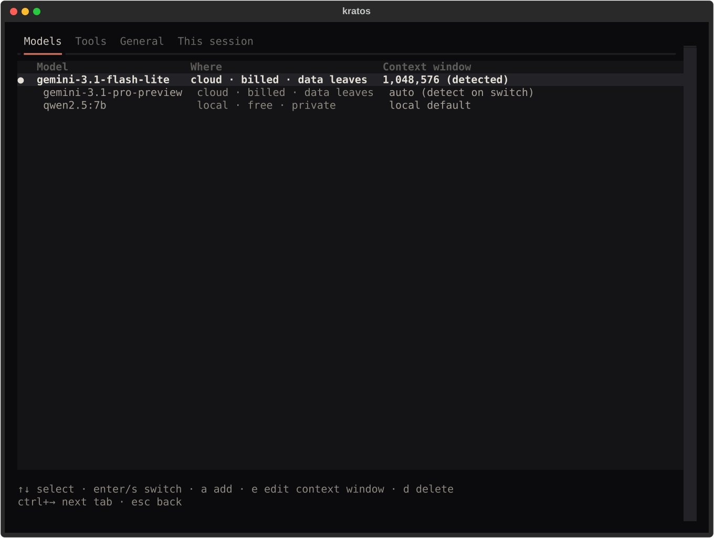
</p>

**Where Kratos keeps things.** If you installed from a git checkout as above,
everything stays in that folder: the settings file `.env`, your sessions and
findings in `data/`, tools you've approved in `kept_tools/`, and the CVE list in
`vulscan/`. If Kratos was installed as a package instead (`pip install` without
`-e`), it uses your per-user folders: settings in `~/.config/kratos/.env`, the rest
under `~/.local/share/kratos/`. To keep everything in one folder of your choice, set
the environment variable `KRATOS_HOME` before starting Kratos. Either way, it
doesn't matter which folder you start `kratos` from, and `/doctor` shows the exact
paths.

---

## The first launch

Start Kratos (in the same terminal, with the `.venv` from the install step active —
if you opened a new terminal, run `source .venv/bin/activate` in the `kratos` folder
first):

```bash
kratos
```

To leave at any time, type `/exit` or press `Ctrl+Q`.

> The first time, Kratos says what it does (reads machines without changing
> them, where what it reads is sent for analysis, where it keeps its data) and
> asks you to continue, then offers to remember a default target. It only asks once. If you
> give it one, Kratos sets that machine up with you (see the next section) and opens a
> session on it. Kratos has no built-in
> target: if you skip that question, the first machine you point it at (with
> `/target` or a new session) becomes the default, which is what command-line and
> scheduled runs use. `KRATOS_SSH_HOST` overrides it for a single command.

Every later launch opens on your past sessions, newest first and grouped by
day. Press Enter to resume the highlighted one, `n` for a new session, or `/` to
filter them by name, machine or last question:

<p align="center">
  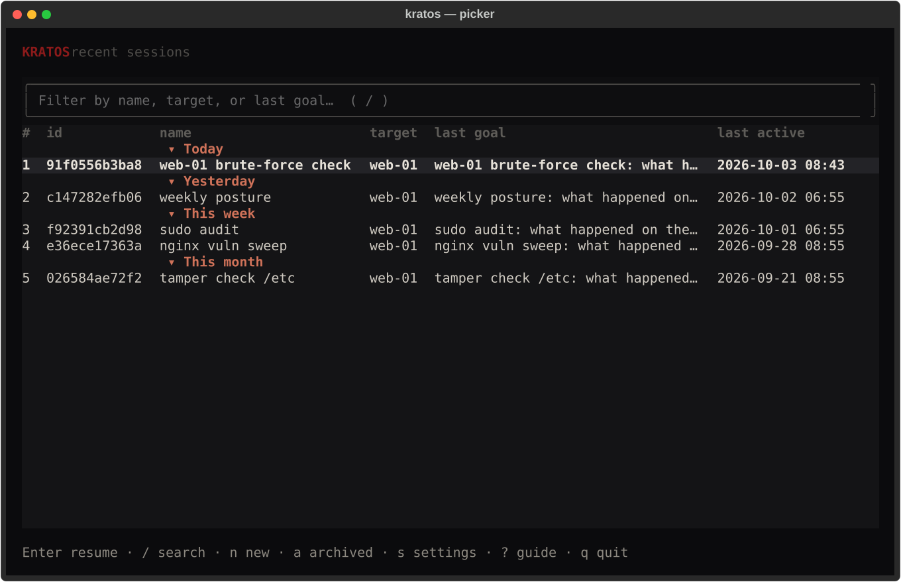
</p>

Once you're in a session, you'll see the home screen:

<p align="center">
  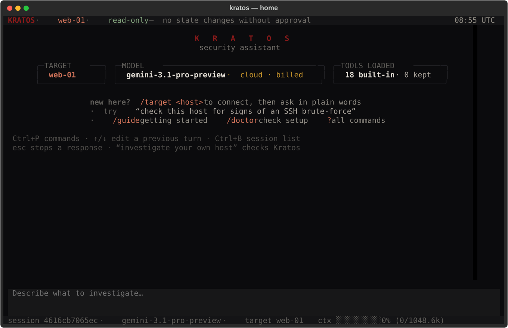
</p>

The three cards tell you, at a glance, which machine is being watched (**target**),
which **model** Kratos is using and whether it's local (free, private) or cloud
(billed), and how many **tools** it has. The tips at the bottom point at the first
things to do. You can type a question at any time, or a command starting with `/`.

Useful to know from the start:

- Type `?` to see every command.
- Type `/guide` for a short in-app version of this walkthrough — you can also open
  it with `?` right from the session picker, before you're even in a session.
- Press `Ctrl+P` to search commands instead of remembering them.

<p align="center">
  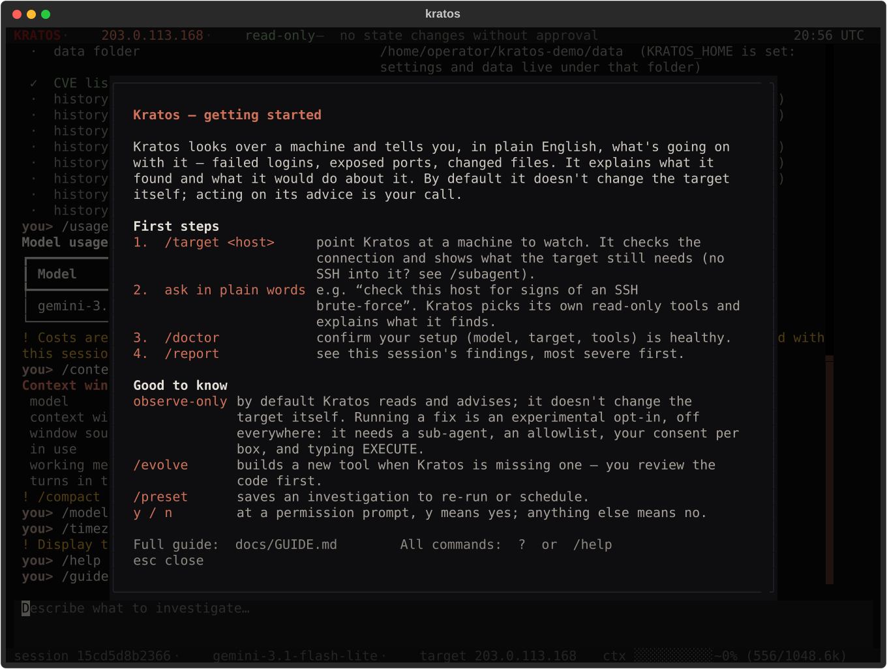
</p>

---

## Connecting a machine to watch

Before Kratos can investigate a machine, it needs to be able to reach it and read
a few things. When you add a new machine, Kratos first asks **how it should reach
the box** — there are two ways, and for most people the first is the right one:

- **Direct SSH (recommended).** Kratos logs into the box over SSH with your key and
  reads its logs, config, processes, and ports — read-only. Nothing is installed on
  the box. This runs every investigation tool, so it's what you want unless you
  have a specific reason not to. You authorize Kratos's SSH key on the box once
  (Kratos gives you the exact command) and make sure it's reachable.
- **Sub-agent (for boxes you can't or won't open to SSH).** You install a small
  agent on the box; it *dials out* to Kratos, so there's no inbound port to open —
  handy for a machine behind NAT or a strict firewall. It streams basic status
  (always-on) and answers investigations with its own fixed set of reads: logs,
  processes, open files, config checks, file hashes and YARA scans. It can't run
  anything else, and Kratos can't send it commands. Two things work differently:
  network scans (open ports, known vulnerabilities) need a direct path from Kratos,
  so they're skipped for a box reached only this way, and the answer says what
  wasn't checked; and YARA uses the rules on the box itself and reports rule, file
  and offset only. Credential files (SSH keys, `.env`, shadow…) are never scanned.
- **Skip for now** — set it up later with `/target` or `/subagent`.

Kratos never guesses which machine a target is. Picking **Sub-agent** links the box
to its agent once it checks in; if you later type an address that looks like a box
you've already paired, Kratos *asks* before linking. `/target link` changes how a
target is reached (sub-agent only, or SSH first with the sub-agent as a fallback),
and `/doctor` shows which way it is reached right now. An agent installed before
this feature needs one update: open `/subagent`, select it and press **g** — it
keeps its pairing.

<p align="center">
  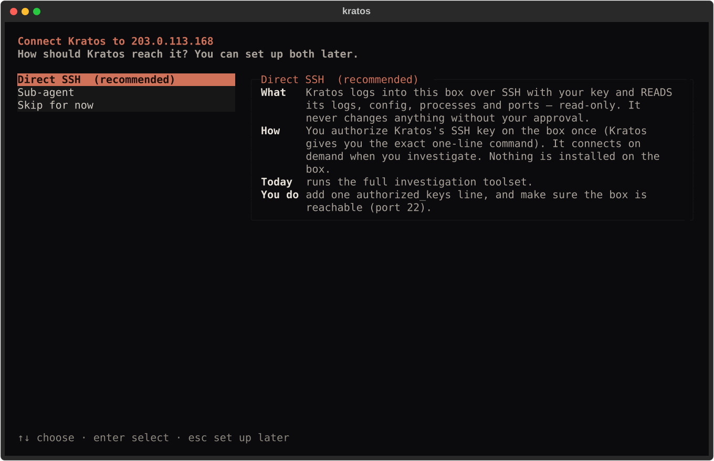
</p>

The rest of this section is the Direct SSH path; the sub-agent path has its own
section, [Machines you reach through a sub-agent](#machines-you-reach-through-a-sub-agent).
Point Kratos at a host:

```
/target 192.168.1.50
```

(Use your machine's address or hostname. To have Kratos look at *its own* computer,
use `/target` and pick the "this host" option, or just ask it to "investigate your
own host".)

**Don't know the machine's address?** Log into that machine (or sit at it), open a
terminal there and run:

```bash
hostname -I
```

It prints one or more addresses; the first one, something like `192.168.1.50`, is
usually the one to use.

**Which account Kratos logs in as.** When you set up a machine over SSH, Kratos
asks — the name you'd use in `ssh NAME@address` (often `ubuntu`, `debian`, `root`,
`ec2-user`, or your own name) — and remembers it for that machine. You can also
type it with the address, as in `/target alice@192.168.1.50`. If a login fails,
Kratos says which account it tried; press `u` on the setup screen to change it.

**Want to try Kratos before setting up another machine?** Skip the target question
and type `/investigate-host is anything unusual listening on this machine?`. That
checks the computer Kratos runs on, and needs no SSH setup at all.

If Kratos hasn't set this machine up before, it asks how to reach it (above), then
checks the connection and shows you a short checklist of anything the target still
needs. A machine it has already set up just gets a one-line "already set up" note.
Typically the checklist covers:

- an SSH key Kratos can log in with,
- permission to read the system logs (either through a group membership or a
  narrow sudo rule) — the `systemd-journal` group for the journal and `adm` for the
  files in `/var/log`,
- two read-only sudo lines for auditd's status (`auditctl -s` and `auditctl -l`),
  if auditd is installed,
- two small helper programs installed on the target (`yara` and `lsof`),
- the SSH port reachable from the Kratos machine,
- and, recommended, **sealing the machine's journal** (see
  [Sealing a machine's logs](#sealing-a-machines-logs)) — one key skips it.

The setup check lists every kind of log Kratos can read on that machine — auditd,
sudo, cron, services, firewall, packages, web server — and for each one says
readable, not readable (with the exact fix), or not present.

<p align="center">
  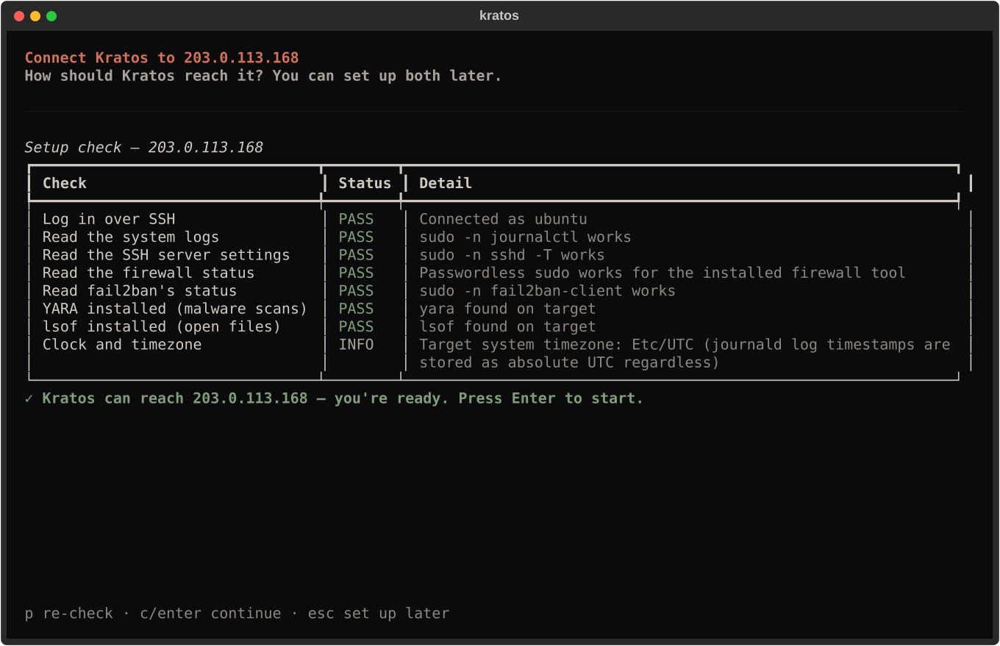
</p>

Kratos doesn't run these fixes for you — it only observes. Instead it gives you
the exact commands to run **on the target** yourself, so you stay in control. Run
them, then check again with:

```
/target verify
```

When every line passes, you're ready. If a check fails, the checklist tells you
what to do about it — and [When something goes wrong](#when-something-goes-wrong)
covers the common cases.

---

## Your first investigation

Just describe what you want to know, in normal words:

```
check this host for signs of an SSH brute-force
```

Kratos takes it from there. It decides which read-only checks to run, runs them
one at a time (you'll see each step appear), pulls the results together, and writes
up what it found with a recommended next step.

<p align="center">
  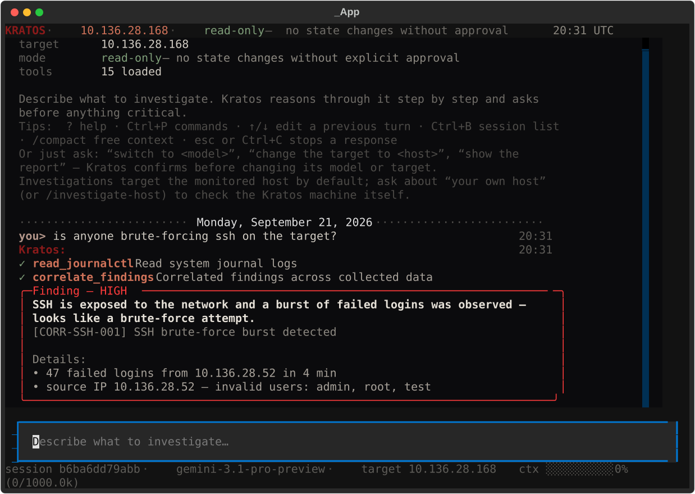
</p>

Other things you can ask, to get a feel for it:

- *"is anything listening on the network that shouldn't be?"*
- *"have any important system files changed recently?"*
- *"who has been using sudo in the last day?"*
- *"who can become root on this box, and was anyone added recently?"* — Kratos lists
  sudo/admin members, root-equivalent groups (docker, lxd, …), extra UID-0 accounts and
  sudoers grants, plus who was added and when, and what changed since it last checked.
- *"is there any malware on this machine?"* — a YARA sweep of the usual drop locations
  (home directories, `/tmp`, web roots, …), reporting exactly which places it scanned
  and what it couldn't read.

You don't have to phrase these a special way. If your request is unclear or could
go several directions, Kratos asks you first (see below) rather than guessing.

**How to read an answer.** When something serious is open on the machine, an answer starts
with **Kratos found** — a list written by Kratos itself, not by the model: every HIGH or
CRITICAL finding with the fact that matters (the attacker's address and whether it is a known
bad one, the program and its process id, the file, the package). Nothing the model writes can
leave one out; an item the write-up below doesn't discuss is marked *(not discussed below)*.

Below that comes the model's analysis — what it means and what to do. Kratos checks it against
what it actually found, and anything it gets wrong comes first as a `[NOTE: …]`, also written by
Kratos:

- *not checked in this investigation* — what could not be looked at this time, one short line
  each (for example processes of other users over a normal SSH login);
- *this answer mentions an address … which appears in nothing Kratos read* — an address the model
  made up;
- and a few others when the write-up's claims about time periods or past state don't match what
  Kratos measured.

The list and the notes are the parts Kratos is sure about; read them first.

---

## What Kratos checks by itself

You don't have to ask for the basics. When an investigation starts, Kratos first checks them
on the machine — in parallel, in a few seconds, without using the model — and only then hands
the question to the model together with a short summary of what it found:

| Checked first | What it tells you |
|---|---|
| open ports | what is reachable from the network |
| sign-ins, last 24 hours | failed and successful SSH logins, bursts, sudo activity |
| log tampering | logs cut short, replaced or wiped |
| privileged accounts | who can become root, and what changed since the last check |
| where someone could keep access | new or backdoor-shaped cron jobs, services, startup files, SSH keys, SUID programs, preload and PAM rules |
| what is running right now | programs that deleted their own file, code running from memory, injected libraries, executables in /tmp |
| vulnerable packages | installed packages with known vulnerabilities, matched on your computer against the distribution's own data |
| configuration | SSH, firewall, fail2ban and other settings |
| log sync | new log lines are copied into Kratos's event store on your computer |

You see one line above the answer, for example
`Checked first: ports (12 min ago) · auth 24 h (now) · tampering (now) · config: not this time`.
Kratos waits at most 15 seconds (the default) before the model starts. A check that needs
longer — on a distant machine the port scan takes a couple of minutes — keeps running in the
background and shows as *still running*; Kratos waits for it briefly again before the answer, so
its findings usually make it in, and its result is reused by the next investigation either way.
"Not this time" means a check ran past its own limit or failed; the answer says so rather than
guessing. Because the basics are checked by Kratos itself, a broad
question such as *"check this system for anything suspicious"* now always includes the
tampering check, whatever the model would have picked.

**Fresh results are reused.** Each check has a freshness limit (sign-ins 15 minutes,
open ports and accounts 60 minutes, configuration and packages 6 hours, log tampering only 10 minutes — new
tampering shouldn't hide behind an hour-old answer; `/collect --force` checks right now), so a second investigation soon after starts
almost instantly. A reused result is never mistaken for a new one: it can't make
a finding look "fixed".

**Do it yourself:** `/collect` (or `kratos collect`) runs the same checks now and shows what
they found; `/collect all` (`kratos collect --all`) adds the slow ones — known vulnerabilities,
a malware-signature sweep, the critical-files comparison — and `--force` re-runs even fresh
results. `/run` (the standard audit) is exactly this, with everything forced. None of it uses
the model, so none of it costs anything. `/doctor` has a "collection" row showing when each
check last ran and whether any log is still catching up.

**Logs stay up to date.** Kratos remembers where it stopped in each security log of a machine
(the sign-in log, cron, services, firewall, auditd, package installs) and fetches only what is
new; those lines are stored on **your computer** (never sent anywhere) so `kratos events` can
show them. Kratos also records which stretches it holds *completely*: if a log was rotated
away, cut short, or the journal was cleaned, that stretch is marked as a gap instead of being
reported as complete — see them with `kratos events --coverage`. Nothing is ever written on the
machine being watched. Web server logs are left out by default (they can be huge). The store
grows with how busy the machine is — on the busy lab server about 14,000 sign-in events a day;
a quiet server a few hundred — and Kratos never deletes it by itself.

**Settings** (Settings → General): whether to check first at all, the time allowed, which logs
to keep up to date, how far back a first sync reaches, how many lines one round takes, and each
check's freshness limit.

---

## Understanding findings

When Kratos finds something, it writes a **finding**: a short, titled result with
the evidence behind it and, usually, a recommended action. Each finding has a
**severity**, shown by color:

- **red** — critical or high. Something that needs attention.
- **amber** — medium or low. Worth a look.
- **green** — informational, or an all-clear.

Type `/report` at any time to see the session's findings again, grouped into
**New**, **Still open**, **Fixed**, **Not rechecked** and **Hidden by your
decisions**. A finding is Kratos's *conclusion*, not an action — it doesn't act on
a finding on its own.

Two things keep answers readable:

- **One problem, one finding.** When several rules spot the same thing (an SSH
  brute-force burst is both "exposed SSH with failed logins" and "a burst of failed
  logins"), Kratos shows one finding at the highest severity and notes which rules
  also matched.
- **No re-listing.** Each answer shows in full the findings that are new or changed,
  from data this investigation collected. Findings already shown, or still on record
  from an earlier check, are folded into one line — *"Also on record — unchanged since
  shown above: …"* — and `/report` shows them all.

**The ATT&CK line.** A finding about something an attacker *did* carries a line like

> ATT&CK: T1110.001 Password Guessing (Credential Access)

It names the matching technique in [MITRE ATT&CK](https://attack.mitre.org), the
public catalogue of attacker techniques that most security teams and tools use, so
you can look the technique up, search other tools for it, or hand it to someone who
speaks that language. The part in brackets is the *tactic* — the attacker's goal at
that step (getting credentials, keeping access, hiding, …). Kratos uses ATT&CK
version 19, where the old "Defense Evasion" is split into **Stealth** and **Defense
Impairment**; older tutorials still use the old name.

Findings about *exposure or weakness* — an open port, an outdated package, the list
of who holds admin rights, a note about what couldn't be checked — have no ATT&CK
line, on purpose: they describe your machine, not something someone did to it. A
changed tracked file is labeled by *which* file changed (`/etc/passwd` → Account
Manipulation, `/etc/crontab` → Cron, `sshd_config` → Modify Authentication
Process); any other file has none. The labels come from one table Kratos ships,
built from MITRE's own data — the model never writes them. In `/findings`, `Enter`
shows a finding's technique with its link and `c` copies the link.

**A map of what Kratos can catch.** `kratos attack-layer` writes a file for the
[ATT&CK Navigator](https://mitre-attack.github.io/attack-navigator/), MITRE's
free web viewer for the catalogue, with every technique a Kratos rule can detect
highlighted. `kratos attack-layer --observed` instead highlights the techniques in
the open and verified findings for the machine you're watching (`--target all` for
every machine), colored by the worst severity; findings you've decided about or that
were fixed are left out. To view one: open the Navigator, choose **Open Existing
Layer → Upload from local**, and pick the file. Highlighted means *a rule can raise
a finding labeled with it* — not that every variant of the technique is caught.

```bash
kratos attack-layer
```

```bash
kratos attack-layer --observed --out myserver-attack.json
```

<p align="center">
  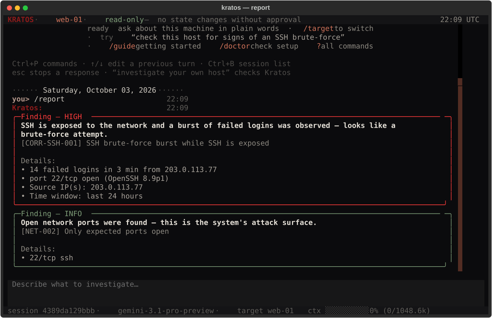
</p>

---

## Keeping track of findings

Kratos remembers its findings from one check to the next. The same problem on the
same machine is the same finding every time, so instead of the same list after
every question you see **what's new, what's still open and what got fixed**. Under
every answer that looked at findings there's a line like:

> New 1 · Still open 3 · Fixed 1 · Hidden by your decisions 2 (/findings)

**What the states mean**

| You see | It means | Who sets it |
| --- | --- | --- |
| open | found, nobody has decided anything about it | Kratos |
| verified | you confirmed it's real; it stays shown | you |
| fixed | a later check looked again and it was gone | Kratos |
| no recurrence | something that *happened* (like a login burst) didn't happen again in a later check | Kratos |
| risk accepted | you know, and accept it until a date you chose | you |
| not a real problem | you marked it a false positive | you |
| out of scope | not relevant for this machine | you |

Kratos only calls something fixed when a later check really looked again — read
the same kind of data, for the same machine, completely. If a check didn't
re-collect it, the finding stays as it was and shows as **not rechecked**. If a
fixed finding turns up again, it comes back as **open** ("regressed", or
"recurred" for something that happened again).

**Deciding about a finding.** Open `/findings` (or `/f`): it lists the open and
verified findings for the machine you're watching. Pick one with ↑↓ and press:

- `v` — confirm it's real (verify)
- `a` — accept the risk until a date (7, 30, 90 or 180 days, or a date you type)
- `f` — not a real problem (false positive)
- `o` — not relevant for this machine (out of scope)
- `r` — reopen something you decided about
- `h` — its history: every change, who made it, when and why
- `Enter` — the full details, including its ATT&CK technique and link
- `c` — copy the ATT&CK technique link

Every decision needs a reason, and accepting a risk always needs an end date —
at most 180 days unless you change it in **Settings → General**. When the date
passes, the finding comes back on its own. A decision can cover just this finding,
this rule on this machine, or this rule everywhere (Kratos asks again before that
last one). `s` switches between open, hidden, fixed and everything; `p` filters by
severity; `m` picks the machine; `/` searches.

**A decision covers what you saw.** If you accept a brute-force finding because
the attempts came from your own scanner, and later the same finding shows a *new*
source IP — or a higher severity — it comes back as open, naming what's new. Counts
going up or down don't bring it back.

**Hidden is never silent.** Decided findings are left out of the default view, but
every answer, `/report`, `/findings` and scheduled notification says how many are
hidden. The model still sees every finding with its state, and Kratos's own answer
checks treat an accepted high-severity finding like any other: an answer can't wave
it away without naming it. Only you can change a finding's state — the model can
suggest, never decide, and nothing over MCP can change one.

**From the command line:**

```bash
kratos findings list
```

```bash
kratos findings accept 3f9c2a1b7d4e --days 30 --reason "our own vulnerability scanner"
```

`kratos findings show KEY` prints one finding's history; `verify`, `fp`,
`out-of-scope` and `reopen` work the same way (each needs `--reason`), and
`--scope rule-target` or `--scope rule` widens a decision. The 12-character key
from `list` is enough. `kratos findings list --state decided` shows what your
decisions hide.

**What's kept.** Finding records, their history and your decisions live in
`kratos.db` in your data folder (tables `finding_records`, `finding_events`,
`finding_exceptions`). They grow by one row per finding and one per change — small.
Nothing is deleted automatically; the old report files in `reports/` stay exactly
as they were, and the first time you run this version Kratos reads them once to
start your history (`kratos findings import-reports` repeats that safely).

---

## How Kratos double-checks a finding

Models are weak at deciding whether a finding is real, so Kratos doesn't ask the
model — it **checks each serious finding again by code**, with a fresh, narrow read
of just the evidence that matters for that finding, and tells you what it found. You
see a short tag next to the finding:

| Tag | What it means |
| --- | --- |
| seen in this run's read — not re-checked yet | the automatic check after an investigation: the finding is in the read Kratos just made — the same read that raised it — so nothing has looked a second time yet. Press `k` in `/findings` (or `kratos findings recheck KEY`) to re-check it |
| reproduced by a fresh read | a second read (re-check, retest) looked again and it's still there |
| partly: *…* | still true, but with something that lowers the risk (e.g. *filtered from Kratos*, *source now banned by fail2ban*, *distro backported the fix*) |
| not reproduced — retest? | a fresh, complete read no longer finds it; it may be fixed |
| couldn't check: *…* | no safe fresh read was possible, and why (e.g. *the logs for that time are no longer there*) |
| verifying… | the re-check is still running; it finishes in the background |

A verdict more than an hour old says how old it is — *reproduced by a fresh read, 2 days
ago* — wherever it is shown, so an old check doesn't read like a new one. An automatic check
from an earlier investigation reads *seen in a read 2 days ago — not re-checked yet*.

**Conditions vs. things that happened.** A *condition* (a vulnerable package, an
open port, a setuid file) is re-read *now* — is it still there? Something that
*happened* in a window (a failed-login burst at 03:14) is re-checked against the
logs **for the time it happened**: if the burst is still in the logs for that
window it is *reproduced*, even though it's over. Only if the logs for that time
are gone does Kratos say *couldn't check*.

**Where reachability is tested.** When Kratos re-checks whether a port is exposed,
it probes from **Kratos's own machine** — not from the public internet. The answer
says so: "reachable from here". A port that's open to the world but blocked between
Kratos and the target shows *partly: filtered from Kratos*.

Serious findings are checked automatically after every investigation (and every
scheduled run) against the data Kratos just collected — it doesn't read the machine
twice. Because that is the same read that raised the finding, the tag says **seen in
this run's read — not re-checked yet**, never *reproduced*. Only a genuine second read
— a re-check (`k`, `kratos findings recheck`) or a retest after a fix — can say
*reproduced* or *not reproduced*. The slower checks (an nmap probe, re-hashing a big
file) run when you ask.

**Did my fix work? — /retest.** After you change something, run **`/retest`** (in
the TUI, on the selected finding) or `kratos findings retest KEY`. Kratos
re-collects exactly what covers that finding -- always from the machine the finding is
about, whichever machine is active -- updates its state, and tells you whether it's gone:

```bash
kratos findings retest 3f9c2a1b7d4e
```

If the re-collection couldn't look at everything (an unreachable machine, a read
that needs more access), Kratos leaves the finding open and says why — it never
calls something fixed on a read that couldn't see it. **`/verify`** (TUI: `v`… no —
press `k` on a finding) / `kratos findings recheck KEY` runs the full re-check,
including the slower reads, on demand. A retest is also offered right after you
apply a fix Kratos recommended.

**The model's suggestions.** The model may add a note that a finding looks like a
false positive, is less serious, or needs a person to judge — shown labelled **"the
model suggests"**, never as a state and never in Kratos's own findings block. Only
you act on one: accept it through the normal decision (`a`/`f`/`o`, with the reason
prefilled from the suggestion) or dismiss it (`n` in `/findings`, or
`kratos findings suggestions --dismiss ID`). `kratos findings suggestions` lists
them. The model can suggest; it can never decide.

---

## Reading more of a machine's logs

Besides logins and sudo, Kratos can read seven more kinds of log on a machine, in
any time window you ask about. You don't have to name them — ask "what ran on this
box last night?", "was anything installed this week?" or "who is probing the web
server?" and Kratos picks the right one. Each read comes back as a summary (counts,
the busiest IPs and users, a few notable lines with passwords and tokens blanked
out) plus exactly what it covered.

| Log | What it tells you | What Kratos needs on the machine |
| --- | --- | --- |
| **auditd** | every program run, login and account change auditd recorded | auditd installed with rules; its log readable by the `adm` group (setup step 2) |
| **sudo** | who ran what as root, and failed sudo attempts | the journal (`systemd-journal` group); sudo's own log file if you set one |
| **cron** | scheduled jobs that ran, with the user and the command | the journal; `/var/log/cron` on Rocky/RHEL |
| **services** (systemd) | services started, stopped, failed or reloaded | the journal (not on Alpine, which uses OpenRC) |
| **firewall** | connections the firewall blocked or allowed and logged | the journal; on a container these lines live on the host, and Kratos says so |
| **packages** | software installed, upgraded or removed, and the command | `dpkg.log` / `apt` history (Debian, Ubuntu), `dnf` logs (Rocky/RHEL); Alpine keeps none |
| **web** | requests to nginx or Apache, and their errors | the web server's logs readable by the `adm` group |

Kratos reads the current file and its first rotation (`.1`), never the compressed
older ones; if those matter for the time you asked about, the answer says that part
of the window is unknown rather than clean. Anything it couldn't read is stated
with the fix — never quietly skipped. Through a sub-agent the same logs are read by
the agent on the box (as root), so no group membership is needed; Kratos still
refuses any log file that is a link to somewhere else.

## Detecting log tampering

Someone who breaks in often tries to hide it by editing the logs. Kratos looks for
that — not just "is logging switched on" — every time you ask whether a machine was
tampered with, and in the standard audit (`/run`). It notices:

- a log file **cut short, replaced or rewritten** outside normal log rotation
  (normal rotation — renaming or copy-and-truncate — is recognized and ignored),
- a **journal file missing from the middle** of the machine's history (the journal
  only ever removes its oldest files by itself),
- **login records** (`wtmp`, `btmp` — what `last` and `lastb` show) with a record
  wiped to zeros or out of time order,
- **auditd stopped**, disabled, or emptied of its rules,
- a **boot that ended without a clean shutdown** — a crash, a power cut or a forced
  restart; context, not proof.

The very first check of a machine only records how its logs look; changes are
judged from the second check on. What it finds becomes findings `LOG-001` to
`LOG-005`, each labeled with the matching MITRE ATT&CK technique (for example
*T1685.006 Clear Linux or Mac System Logs*). Evidence of tampering **stays open
until you decide on it** — a later check that sees nothing new doesn't close it,
because the logs it now compares against are the edited ones.

Deciding on a tampering finding covers the incidents you saw, not the next one: if
you mark "auth.log was cut short" as expected maintenance and it's cut short again
later, the finding comes back with the new incident. (If something on the machine
legitimately truncates a log, let logrotate do it — Kratos recognizes rotation.)
An installed but stopped auditd is shown separately (`LOG-006`, info) and goes away
once auditd runs again.

## Where someone could keep access (persistence)

Once an intruder is in, they want to stay in across reboots and password changes.
On Linux there are many places to hide a line that re-launches their access: a
cron job, a systemd service or timer, an SSH key, a startup file like `.bashrc`,
a program with the setuid bit, the dynamic-linker preload, a login (PAM) rule, a
udev rule, a package-manager hook. Kratos checks all of them, by itself, as part
of the basics — you don't have to ask — and in the standard audit (`/run`).

It reports a place only when there is a reason to:

- **new since Kratos first looked.** The first check of a machine records every
  such place as the baseline; from then on, something that **appeared or changed**
  and that **no installed package owns** is reported (`PERSIST-001`). "Owned by a
  package" is the main filter — the thousands of cron jobs, services and PAM rules
  a normal system ships are left out.
- **shaped like a backdoor** (`PERSIST-002`, "worth a look", never a verdict): a
  line that runs a program from `/tmp` or a hidden folder, downloads and runs
  something, decodes hidden text and runs it, opens a shell over the network, or
  makes every program load an extra library. These patterns also show up in normal
  software, so this is a prompt to read the line, not an accusation. If a *new*,
  unowned place also has one of these shapes, it is raised to high.
- **a program that runs with its owner's powers** (setuid/setgid) that **no package
  installed** (`PERSIST-003`) — a classic way to keep root.
- **the dynamic-linker preload is in use** (`PERSIST-004`) — a library listed in
  `/etc/ld.so.preload` runs inside every program, which is how a rootkit hides.
- **a kernel module from outside the system's packages** (`PERSIST-005`).
- **a new SSH key, or one with backdoor-ish options** (`PERSIST-006`).
- **a package's own file changed** from what it shipped (`PERSIST-007`, in the full
  audit only — it asks the package manager to verify its files, which is slow).
- **a login (PAM) rule pointing at software no package installed** (`PERSIST-008`).

Each finding shows the path, owner, mode and a short, masked excerpt of the lines
that execute something — never whole files — and carries the matching MITRE ATT&CK
technique. A finding stays open until you decide on it; because a place is named by
its path **and** its content, a *changed* line reopens a decision you already made,
while an unchanged one stays decided.

**What SSH can't see.** Over a plain SSH connection Kratos reads as your SSH user,
so other users' home folders, `/root`, and other users' crontabs come back as a
**coverage gap** (`PERSIST-009`, "not checked" — unknown, not clean) with the fix:
connect the machine through its sub-agent, which reads as root. A location that
wasn't read is never reported as empty.

**Settings:** the persistence check's freshness limit is in Settings → General
(with the other checks); whether the slow package-file verification runs in the
full audit is `persist.verify_packages` there too.

## What's running right now

Persistence is about what an intruder left *on disk* to come back later; this
check is about what is *running at this moment*. Kratos looks at every process
(`/proc`) for the classic signs of a live intrusion, by itself, as part of the
basics and in the standard audit:

- **a program that deleted its own file while still running** (`LIVE-001`). Malware
  often unlinks its executable so there is nothing left on disk to scan. This is
  also normal right after a package update — but then the file exists again and
  belongs to a package, and Kratos tells those two cases apart (see the
  restart-needed note below).
- **a program running from memory or a just-deleted temporary file** (`LIVE-002`):
  a `memfd:` executable, or an executable deleted out of `/tmp` or `/dev/shm`.
  Running code that never touched disk is a common way to hide a payload. (A program
  copied into a temp folder, started and then deleted is reported here, as `LIVE-002`,
  rather than as `LIVE-001`.)
- **a process started with `LD_PRELOAD` or `LD_AUDIT`** pointing at a library no
  package owns (`LIVE-003`) — how a userspace rootkit loads itself into everything.
  A library a package *does* own is shown as "worth a look", not high.
- **an executable sitting in a world-writable directory** — `/tmp`, `/dev/shm`,
  `/var/tmp` (`LIVE-004`): high if a process is running it right now, medium if it
  is only present.
- **a network listener run by a suspicious process** (`LIVE-005`): something
  accepting connections that was started from `/tmp`, from a deleted file, or from
  a binary no package installed — a likely backdoor.
- **a shell or interpreter started by a web server or database** (`LIVE-006`) — the
  classic web-shell / exploited-service shape.

Each finding names the process (pid, command, the user it runs as) with the command
line masked and capped, and carries the matching MITRE ATT&CK technique. Because a
process is identified by its program, pid **and** start time, the same process is
the same finding across runs, and a reused pid is a new one.

**The restart-needed note.** After you upgrade a package, long-running services keep
the old (now-deleted) binary until you restart them. That is normal, not a
compromise, so Kratos does **not** raise `LIVE-001` for it — it adds a quiet
info note (`LIVE-007`) listing which processes to restart (for example
`systemctl restart <service>` or a reboot).

**What SSH can't see.** Over a plain SSH connection Kratos reads as your SSH user,
so other users' processes — their program, environment and open files — are not
readable. Those come back as a **coverage gap** in `LIVE-007` ("not checked —
unknown, not clean") with the fix: connect the machine through its sub-agent, which
reads as root and sees every process. Kratos never sends an environment variable's
value except the `LD_PRELOAD`/`LD_AUDIT` library path (masked), and never kills
anything — a recommendation like `kill <pid>` is shown for you to run, never run for
you.

The same note says when the SSH login could not open a folder under `/tmp` or
`/var/tmp` (systemd's private temp folders are the usual ones), and when `/proc` is
mounted with `hidepid`, which hides other users' processes from a normal login
completely. Something a read could not look at is never taken as gone: a finding the
sub-agent raised about a root process stays open after a later SSH read that could
not see that process, until a read that *can* see it says it has ended.

A very large executable dropped in a temp folder is listed but not hashed (over 64 MB,
on both connections), so it cannot use up the check's time.

## Vulnerable packages

Kratos reads the list of **installed packages** on each machine (`dpkg`, `rpm` or
Alpine's `apk` — a quick, read-only listing) and checks every package against its
distribution's own security advisories, **on your computer**. The package list is never
sent anywhere: Kratos downloads whole public data files once in a while and matches
offline.

**Why the distribution's data matters.** Distributions often fix a vulnerability in the
version they ship ("backporting") without changing the version number. A scanner that
compares version numbers with CVE descriptions — like the network check `VULN-001` —
reports those as vulnerable when they aren't. Kratos uses the distribution's own record of
which package version fixed each CVE, so a backported fix is not reported. When the
network check matched a CVE that the installed packages already fix, `VULN-001` says so
("the network match is likely wrong — a backported fix") and leaves that CVE out of what
you're asked to decide — **unless** Kratos saw that the program actually listening on
that port is not the one from the fixed package (a build in `/usr/local`, a copy no
package installed, something running from memory). Then the CVE is kept, and
`VULN-001` says which program answers on the port and why the package fix may not
apply to it.

**What you see** — for fixable vulnerabilities, one finding per package (so `openssl` with twelve CVEs is one
finding):

- `PKG-001` — **an update fixes it.** The finding lists the installed version, the
  version that fixes it, the most urgent CVEs, and the command to upgrade (shown for you
  to copy; Kratos never runs it). How urgent:
  - **critical, "act now"** — a CVE is on CISA's list of vulnerabilities attackers are
    exploiting right now (KEV). Upgrade this first.
  - **high** — serious (CVSS 7 or more) *and* likely to be exploited soon: an EPSS score
    of at least 10% (EPSS estimates the chance of exploitation in the next 30 days; 10% is
    the threshold most often used in practice — change it with the setting
    `vulndb.epss_high`).
  - **medium** — serious (CVSS 7+), not known to be exploited.
  - **low** — the rest. A CVE the distribution itself rates "negligible" or
    "unimportant" never goes above low.
- `PKG-002` — **no fix released yet.** The distribution knows about these but hasn't shipped
  fixed packages. There is nothing to install today, so this is **one** finding for the whole
  machine, listing each package and its most urgent CVE — visible so you know, without
  burying the rest (low, or info when the distribution rates every one of them negligible). An unfixed CVE on the
  exploited-now list is critical: limit who can reach that software until a fix ships.
- `PKG-003` — **a newer kernel is installed than the one running.** The kernel fixes only
  apply after a reboot (medium; high if the running kernel has an exploited-now CVE).
  After the reboot the finding closes by itself.
- `PKG-004` — what couldn't be checked: no vulnerability data downloaded yet, data older
  than a week, a distribution Kratos has no data for. Those packages are **unknown, not
  safe**.

A package's finding names its CVEs, so if you accept the risk for `curl` and a new CVE for
`curl` appears later, the finding comes back (the same goes for the "no fix yet" list: a new
entry brings it back). Once you upgrade, the next package check marks
it fixed.

**Getting the data: `kratos vulndb-update`.** Run it once after you've checked your
machines (it downloads the data for the distributions it has seen), then about once a week:

```
kratos vulndb-update                 # the releases of the machines Kratos knows
kratos vulndb-update --ecosystems ubuntu:22.04,debian:12   # or name them
kratos vulndb-update --status        # what the data holds and how old it is
kratos vulndb-update --about         # the data sources and their terms
```

The first run takes a while (about 10–15 minutes: Ubuntu's data alone is ~780 MB to
download, and NVD's CVSS scores are read year by year); after that only what changed is
fetched (usually under a minute). The data lives in `vulndb/vulndb.sqlite` in your data
folder — about 160 MB for one Ubuntu release, about 200 MB for six releases (Ubuntu 22.04
and 26.04, Debian 12, Rocky 9, two Alpine) — and can be deleted at any time; the next
update rebuilds it. A
failed or interrupted update keeps the previous data untouched. Investigations never go
online for this data. If the data is more than a week old (`vulndb.max_age_days`), every
package result says so.

To keep it current without thinking about it, add a weekly timer, for example a user
crontab line: `0 4 * * 1 kratos vulndb-update >/dev/null 2>&1` (Kratos doesn't schedule
network downloads on its own).

**Supported:** Debian, Ubuntu, Alpine, Rocky Linux, AlmaLinux and Red Hat Enterprise
Linux, by release. Other distributions (and Linux Mint, CentOS, testing/rolling releases)
get a clear "no data for this distribution" note. Ubuntu Pro / ESM packages are matched
against the plain release's data. Not covered: language packages (pip, npm …) and
container images.

**The data and its terms.** OSV.dev's exports of the distributions' advisories (Ubuntu:
CC BY-SA 4.0; Red Hat: CC BY 4.0 © Red Hat, Inc.; Rocky Linux: BSD; AlmaLinux: MIT;
Debian and Alpine: no licence stated), CISA's Known Exploited Vulnerabilities catalogue
(CC0), FIRST's EPSS scores (published freely by Empirical Security), and CVSS scores
from NVD — *this product uses data from the NVD API but is not endorsed or certified by
the NVD.* `kratos vulndb-update --about` prints these notices.

## Detection rules

Besides its own checks, Kratos runs **98 detection rules from SigmaHQ**
([github.com/SigmaHQ/sigma](https://github.com/SigmaHQ/sigma)) over the logs it collects
from each machine. Sigma is a shared, open format for describing suspicious log entries —
"someone cleared the system log", "a new account with UID 0", "a shell started by a web
server", "`chattr -i` on a system file" — written and reviewed by security people around
the world. Each rule keeps its **author**, and every finding, alert and report entry a rule
raises names that author (the rules are under the Detection Rule License 1.1, which asks for
exactly that).

**Kratos's own rules.** SigmaHQ's Linux rules are mostly about program starts and file
changes, which need auditd, and none of the shipped ones count events. So on an ordinary
machine without auditd they would miss the commonest signs of a break-in. Kratos adds **7
rules of its own** for what every Linux machine logs anyway. Their findings are named
`KRATOS-…` and say "Kratos's own rule" instead of naming an author:

| Rule | Level | Fires when |
| --- | --- | --- |
| `KRATOS-SSH-BRUTEFORCE` | medium | 10 or more failed SSH logins from one address within 5 minutes |
| `KRATOS-SSH-ROOT-LOGIN` | medium | someone logs in over SSH straight to `root` |
| `KRATOS-SUDO-NOT-IN-SUDOERS` | medium | an account without sudo rights tries to use sudo |
| `KRATOS-SUDO-PASSWORD-BURST` | medium | 3 or more wrong sudo passwords by one account within 10 minutes |
| `KRATOS-ACCOUNT-CREATED` | medium | a new account for a person (user id 1000 or more) is created |
| `KRATOS-ACCOUNT-PRIVILEGED-GROUP` | high | an account joins a group that can become root (`sudo`, `wheel`, `admin`, `docker`, `lxd`, `libvirt`, `disk`, `shadow` …) — the finding names the account and the group |
| `KRATOS-ACCOUNT-UID0` | critical | an account is created with, or changed to, user id 0 (a second root) |

An SSH brute force is **medium** on purpose: a server open to the internet sees one every
few minutes, so it doesn't reach your phone with the ready-made alert (high and critical
only). It still shows in answers, `/findings` and `/detect`. The account rules read the
lines `useradd`, `usermod`, `gpasswd`, `passwd` and similar tools write to the system
journal. Kratos reads those from the moment it (and, on a sub-agent machine, its agent
— 0.9.1 or newer) is updated; account changes made before that are still reported by the
privileged-accounts check. Turn a rule off per machine like any other (below).

**How it runs.** Each time Kratos collects from a machine (an investigation, `/run`,
`/collect`, a schedule), log sync stores the new log lines and the rules then check those
lines, on your computer — nothing extra is read from or sent to the machine, and no model
is involved. A match becomes a finding named `SIGMA-` plus the first 8 characters of the
rule's SigmaHQ id (for example `SIGMA-08F26069`, *User Has Been Deleted Via Userdel*), with
the rule's own level (info, low, medium, high, critical) and its ATT&CK labels. The finding
lists the stored log lines it matched; `kratos events --rule SIGMA-08F26069` prints them.
A match stays an open finding for 24 hours (`detect.finding_window_hours`); after that, with
no new match, it is marked "no recurrence".

> **On schedule, or continuously.** The rules see a machine's logs when Kratos collects
> from it; between collections nothing is checked — answers and `/detect` say so. A machine
> with a sub-agent can instead be **watched continuously**: its agent runs the same rules on
> each log line as it is written and you are alerted within seconds — see
> [Watching a machine continuously](#watching-a-machine-continuously).

**What the rules need.** Many rules look at **program starts** and **file changes**, which
only **auditd** records. Without auditd, those rules can't see anything — Kratos says so
plainly, in the investigation's notes, in `/detect` and as an `info` finding
`DETECT-001` ("what could not be checked on this machine"), never as "nothing found":

| The rules read | Kratos gets it from | Without it |
| --- | --- | --- |
| Linux logs, SSH, sudo, cron, system log (17 rules, plus Kratos's own 7) | log sync (on by default) | — |
| the audit log (23 rules) | auditd's log (`/var/log/audit/audit.log`) | not checked |
| program starts (53 rules) | auditd with a rule recording every `execve` | only commands run through sudo are checked |
| file creation (5 rules) | auditd watch rules (`-w <path> -p wa`) | not checked |

To give Kratos program starts on a Debian/Ubuntu machine: `sudo apt install auditd`, then add
`-a always,exit -F arch=b64 -S execve -k exec` (and, for file rules, watches such as
`-w /etc/sudoers.d -p wa -k sudoers`) to a file in `/etc/audit/rules.d/` and run
`sudo augenrules --load`. Kratos reads the audit log the same way as the others (see
[Reading more of a machine's logs](#reading-more-of-a-machines-logs) for read access).

**Which rules ship, and why not the others.** Kratos takes SigmaHQ's Linux rules at a pinned
version and keeps the ones it can run **exactly as written**: rules that are stable or tested,
whose every field Kratos's logs have, with no regular expressions (a rule needing one is
left out, never approximated), at level medium or above (lower levels are "notable only in
numbers" — Kratos raises a finding per match), not for VMware ESXi, and not routine
discovery commands that admins run every day. `kratos detect rules --skipped` lists every rule
left out, with why.

**Turning a rule off.** A rule that is noisy on one machine (a backup script that toggles
immutable flags, a tool that deletes test users) can be turned off for that machine, or
everywhere — with a reason, recorded with your name:

```
kratos detect rules disable SIGMA-34979410 --target web-01 --reason "backup job uses chattr"
kratos detect rules enable SIGMA-34979410 --target web-01 --reason "backup job gone"
```

or in the TUI: `/detect`, select the rule, `x` (this machine) or `e` (every machine). A
single false alarm is better marked in `/findings` ("not a real problem", scope "this rule
on this machine"); turning the rule off stops it from looking at all.

**The commands**

```
kratos detect rules                  # every rule: level, what it reads, title, author, on/off here
kratos detect rules --skipped        # the SigmaHQ rules not shipped, with why
kratos detect run --target web-01    # run the rules now over the logs Kratos holds
kratos events --target web-01 --rule SIGMA-08F26069   # the log lines a rule matched
kratos detect import my-rules/       # compile your own Sigma rules (needs the 'sigma' extra)
```

`/detect` in the TUI shows the same: the rules with their authors, on/off for this machine,
the rules not shipped (`s`), when the rules last ran here and what they could not check, and
`r` to run them now. `/doctor` shows the pack version and when each machine was last checked.

**Kratos's own commands don't count.** On a machine that records every program start, the
audit log also holds the commands Kratos itself runs to check the machine (a search for setuid
programs looks just like an attacker's reconnaissance). Kratos recognises its own SSH logins — by
its key, in the machine's own logs — and leaves those commands out; another login on the same
account is still checked. The same goes for its SSH logins themselves: if Kratos logs in as
`root`, its own logins don't raise "Root logged in over SSH" (a login as root with any other
key still does). `kratos collect` says how many it set aside.

**Your own rules.** `kratos detect import <file or folder>` compiles Sigma rules you wrote
or picked (it needs pySigma: `pip install 'kratos-security-assistant[sigma]'`, Python 3.11+).
Each is checked like the shipped ones: a rule that needs something Kratos can't do exactly is
listed and left out. Counting rules (Sigma `event_count` correlations — "5 failed logins from
one address within 5 minutes") are supported, grouped by one field — for SSH logs, `SourceIp`.
Each group is its own finding: on a server open to the internet a per-address rule finds many
scanners (27 addresses in one day on a real one), so mark the rule "not a real problem" for that
machine in `/findings`, or keep it for machines that shouldn't see any. Imported rules live in
`detect/packs/` in your data folder and run from the next pass on.

## Watching a machine continuously

On a machine reached through a **sub-agent** (agent 0.9.0 or newer, encrypted link), its
agent can follow the logs **as they are written** and run the detection rules on every new
line. A match reaches Kratos in seconds, becomes the same `SIGMA-…` or `KRATOS-…` finding as
on schedule, and fires your triggers — so an alert can be on your phone a few seconds after the attack.

**Turning it on.** It is off on every machine until you turn it on, one machine at a time:
`/subagent`, select the machine, press **`w`**, confirm. Or `kratos detect watch on db-01`.
Off again the same way. A machine whose agent is too old says *update to watch* — press `g`
first. Kratos refuses to turn it on over an unencrypted link, because matched log lines
cross it.

**What it reads.** The systemd journal — SSH and sudo, cron, services, the kernel's
firewall lines: the same sources log sync collects — and, where auditd runs, its log
(`/var/log/audit/audit.log`). Text log files (`auth.log`, web server logs) are not followed
yet; the scheduled pass still checks them. A machine without auditd shows *not available on
this machine: auditd*: the program-start and file rules then only run on schedule (and only
over what auditd would have recorded, which is nothing — see the table above). Kratos's own
rules — SSH brute force, root logins, sudo misuse, new and privileged accounts — need only the
journal, so a machine without auditd is still watched for those (agent 0.9.1 or newer for the
account rules). The confirmation when you press `w` says this, and `i` shows what the agent
reports.

**What it sends.** Only what a rule matched: the rule, the time, and the few fields of that
log line the rule looked at (masked like everything Kratos stores) — never the surrounding
log. The full lines still arrive through log sync, and the same match found later on
schedule is stored once. Nothing on the machine is ever changed: a match never kills,
blocks or bans anything; it only becomes a finding and an alert.

**Your first alert.** The first time you turn watching on, Kratos offers a ready trigger —
*Alert me on HIGH and CRITICAL detections* (a notification for a high or critical finding
that is new or reopened, at most once every 15 minutes). It is created only if you say yes;
change or delete it with `/trigger`. If phone notifications aren't set up yet, the offer says
so — the alert would be created but could reach no one until you set a topic (see
[Getting alerts on your phone](#getting-alerts-on-your-phone)). Matches from one machine that arrive within 5 seconds of
each other become **one** alert listing the rules (`detect.alert_batch_seconds`). Your
triggers' cooldowns and the daily limit on fires per trigger (Settings → Budget) apply
unchanged — a busy machine reaches the default of 10 fires a day quickly, so raise it if you
want every burst. A trigger set to *investigate* still needs "Triggers may start
investigations" in Settings → Budget.

**Alerts while Kratos is closed** need the **always-on listener** (`/subagent`, `l`): the
agent sends its matches to whatever listener is running. With no listener, the agent keeps
watching and keeps up to 2,000 matches (5 MB) on the machine until one is back, then sends
them — each arrives once. Past that, the oldest are dropped and Kratos says how many.
`/doctor` warns when watching is on but no always-on listener runs.

**"Watching since" and DETECT-002.** `/subagent` shows *watching 3h · 12/min* for each
watched machine (how long, log lines a minute, and the lag when it is catching up); press `i`
for each log's state. When watching is on but **isn't running**, Kratos opens a medium finding
**DETECT-002** *Continuous detection isn't running on this machine*, with the reason:

- the watcher stopped (journalctl kept failing, auditd isn't running);
- the agent's link has been down longer than 10 minutes (`detect.watch.offline_minutes`);
- the agent is connected but has said nothing about watching for 3 minutes;
- the agent refused the rules (they're shown with why), or it is too old.

It closes by itself when watching resumes. If the agent had to skip part of a log — the
journal was cleared before it read it, it was stopped for longer than it catches up on (6
hours or 200,000 lines after a restart), or the link was down longer than its 2,000 kept
matches — the same finding says *Continuous detection missed part of this machine's logs*,
with the times, for an hour. Those stretches are kept and shown under `i`; they are never
treated as "nothing found".

**What it costs.** Measured on a lab machine over a half-day soak: the agent's own memory
stays around 24 MB and flat (the `journalctl` it starts shows a larger number, but almost all
of that is the journal files it maps — shared with the system, not the agent's own memory), its
CPU averages about 0.2% of one core (never above 2%), and it opens no new files over time. The
data it sends is tiny — a few megabytes a day of heartbeats and alerts. A watched security event
reaches your phone in well under 30 seconds (about 6 seconds in the lab, most of it a deliberate
5-second window that groups a burst into one alert). Under a flood it sends at most 20 matches of
one rule a minute and then one "+N more" summary (`detect.watch.max_per_rule_minute`), and while
catching up after a restart it keeps its own CPU use under a quarter of one core and runs at low
priority.

```
kratos detect watch                 # which machines are watched, and how it is going
kratos detect watch on db-01        # turn it on (a person's choice; refused inside an agent tool)
kratos detect watch off db-01
```

## Hunting for an address, account or file

`/hunt` answers "has this address — or this file hash, account, domain, program or path —
appeared on my machines, and when?" from **everything Kratos already holds**: the log lines it
synced and read, the detections, the saved process and persistence reads, the installed-package
lists and the findings. It takes a second or two, uses no model, and sends nothing to any
machine.

```
/hunt 203.0.113.9                       # an address
/hunt 203.0.113.0/24                    # a whole network (IPv6 too)
/hunt 9f86d081884c7d65…                 # a file's SHA-256 (64 hex digits)
/hunt alice --type account              # an account
/hunt evil.example.com                  # a domain, from URLs and from the log text
/hunt /tmp/.x                           # a path -- a file, or a program run from there
/hunt 203.0.113.9 --since 30d --machine web-01
```

A word that could be several things (`alice` — an account or a program?) makes Kratos ask.
MD5 and SHA-1 hashes are refused: Kratos keeps SHA-256 hashes only, so it couldn't honestly
say it hadn't seen one.

**What you get.** For each machine where it was found: per log source, how many times, the
first and last time, and how many a day; detections it appears in (with the rule's author);
saved reads that saw it ("program `kworkerd` was running", "file /etc/cron.d/x had this hash");
findings that name it. Then the newest matching log lines, cleaned for display. Something seen
very often — `root`, the machine's own address — is shown as counts with a hint to narrow the
hunt (a shorter `--since`, one `--machine`) rather than a wall of lines.

**What was searched.** Every report ends with what Kratos holds for each machine, taken from its
own records — never guessed from an empty result:

- *auth log: every line held for 2026-09-28 to 2026-10-26* — the stretches log sync collected
  completely; *GAP …* where lines were lost (a cleared journal) and *not synced from … to …*
  between them;
- *journal: watched live since …* and *not watched from … to …* — continuous detection (only
  rule matches are stored from watching; the full lines come from log sync), and the link
  being down;
- *kratos.cron: 41 events Kratos read …* — lines read during investigations, outside a synced
  stretch: partial by nature;
- *PRUNED: events before … were removed on … by …* — what you deleted with `kratos data prune`;
- *not searched: Kratos holds nothing from db-01 for this period* — a machine never synced or
  watched.

So **"not found" always means "not found in what Kratos holds for these stretches"** — a gap, an
unsynced log or a pruned period is unknown, not clean. Addresses, accounts, hashes, programs and
paths are looked up in an index over every stored line; anything else that appears only in the
log text (a domain inside a `curl` command) is searched by scanning the newest 7 days
(`hunt.scan_days`) for at most 3 seconds (`hunt.scan_seconds`), and the report says how many
lines it got through ("searched 6,145 of 6,145 events", or where the time limit stopped it).

**In a session** the hunt's report joins the conversation, so you can ask a follow-up ("what did
that address do after it logged in?"). Kratos indexes lines stored before this feature existed
for a few seconds before each hunt; `kratos hunt --build-index` finishes it in one go.

**When the threat-intel cache learns a malicious address**, Kratos hunts for it by itself over
every machine's stored records — `kratos threat-intel-sync` updates the offline OTX cache (it
needs `OTX_API_KEY`) and then hunts each address no hunt has searched yet (at most 1,000 per
update, `hunt.auto_max_indicators`); `kratos hunt --from-intel` runs only the hunt. An address
that was seen before becomes a high finding **HUNT-001** *An address a threat-intel feed now lists
as malicious was seen on this machine before*, with when, where, the pulse name and what the hunt
could see — and it goes through your triggers like any new finding. Nothing here calls a model
or reaches the network. (New CISA exploited-vulnerability entries aren't a hunt: `kratos
vulndb-update` already re-checks the stored package lists against them.)

**Every hunt is recorded** — who, when, what was hunted, which machines and period, the coverage
and how many records matched: `kratos hunt --history`. What you typed (an account, an address)
is personal data; `kratos data prune --category hunts --older-than 90d` removes old records.

```
kratos hunt 203.0.113.9 [--type …] [--machine …] [--since 30d] [--until …] [--json]
kratos hunt --history
kratos hunt --build-index
kratos hunt --from-intel
kratos threat-intel-sync [--no-hunt]
```

## Sealing a machine's logs

Sealing (systemd's *forward secure sealing*) makes the machine sign its own journal
as it writes it. If anyone — even root — later edits or deletes entries, the
signatures stop matching and Kratos tells you (`SEAL-001`). It's recommended for
every machine you care about, and takes a minute:

1. Kratos shows the commands when you set a machine up (or type `/target seal`).
   You run them **on the machine**: they keep the journal on disk and run
   `journalctl --setup-keys`.
2. That prints a *verification key* — one line like
   `a1b2c3-d4e5f6-a7b8c9-d0e1f2/1a2b3c-35a4e900`. Paste it into the masked box Kratos
   shows (or `kratos seal set-key HOST` and paste). Press `s` to skip instead.
3. That's it. After each investigation of that machine Kratos copies its sealed
   journal files here and checks them in the background (at most once an hour,
   never slowing anything down); `/target seal verify` or `kratos seal verify HOST`
   checks right away. A file that has been checked once is only re-hashed after
   that; if it ever changed, that is reported too.

**The key never leaves this computer.** It's kept in your data folder under
`fss/` (readable only by you), never sent to the machine, to the model, or into
logs and transcripts. Keep it off the machine: anyone who can read it there could
forge seals. (One limit, stated plainly: while a check runs, the key is on the
command line of this computer's own `journalctl` for a moment, so another user on
this computer could see it in the process list.)

**If you lose the key**, nothing breaks — Kratos just can't check the seals any
more and says so. Run `sudo journalctl --setup-keys --force` on the machine and give
Kratos the new key. If the machine is reinstalled, Kratos notices the key belongs
to the old one and asks you to set sealing up again. If new journal files stop being
sealed (for example the sealing key on the machine was deleted), that is `SEAL-002`.
The two settings for this — how often the background check may run, and how much
journal one check copies — are in Settings → General; Settings → This session has
the machine's sealing key (set, replace, remove, verify now).

## When Kratos asks you a question

Sometimes a request genuinely could go several ways — how deep to look, or which
machine you meant (*"check this machine"* could be the one you're watching or the
Kratos machine itself). Instead of guessing, Kratos asks, and lays out the choices
with one recommended:

<p align="center">
  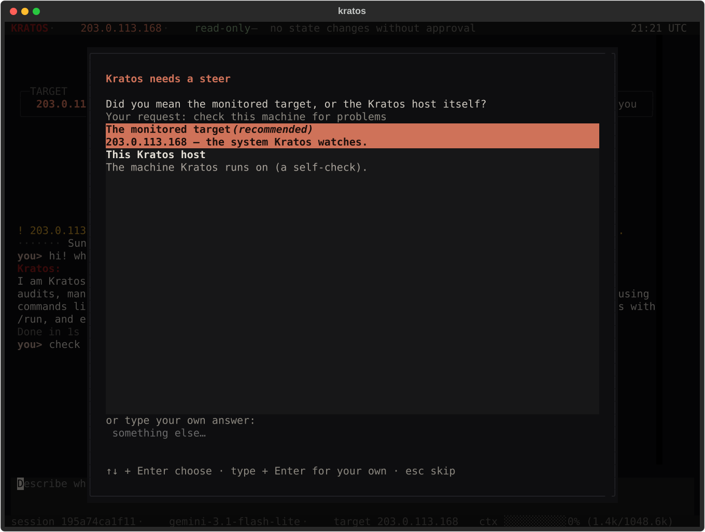
</p>

Use the arrow keys and Enter to pick one, type your own answer instead, or press
`Esc` to let Kratos decide. This is just a question — answering it never gives
Kratos permission to change anything.

---

## When Kratos asks permission

A few actions have real consequences: running a command on the Kratos machine
itself, or keeping a new tool Kratos wrote. For those, Kratos stops and asks for a
plain yes.

The rule is simple and always the same: **`y` means yes. Anything else — `n`,
Enter, Escape, closing the prompt — means no.** If you're unsure, just press
Enter; the safe answer is the default. Kratos will never take a silence or a
mistyped key as a yes.

<p align="center">
  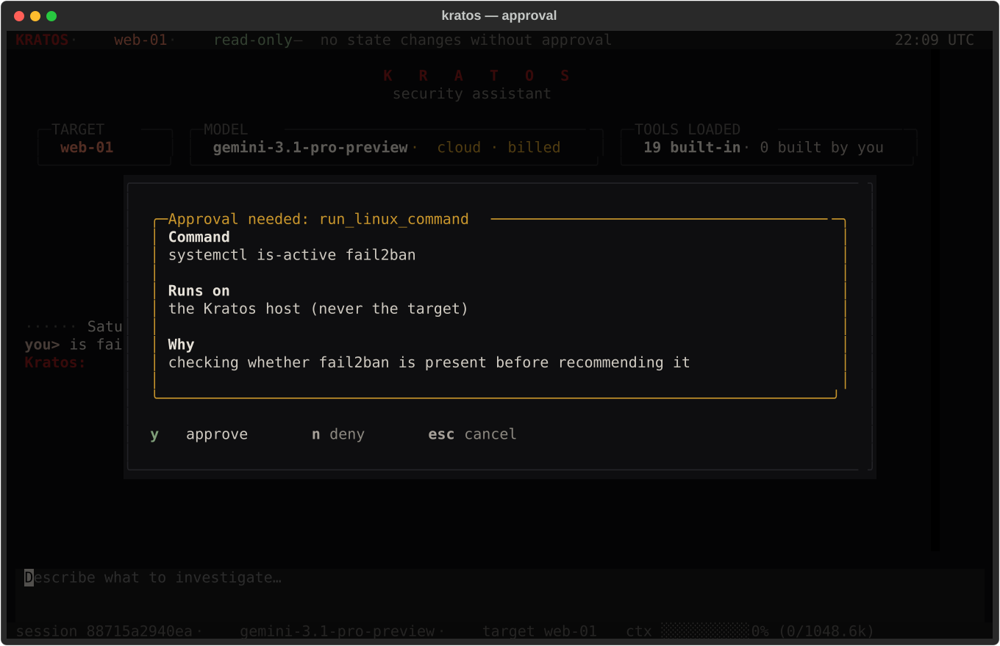
</p>

Note the difference from the previous section: a *question* (clarify) helps Kratos
decide how to proceed and grants nothing. A *permission* prompt is the gate before
something with consequences actually happens.

---

## Text from the machine is treated as untrusted

Anything written by the machine you are watching — a username someone tried to log in
with, a web address, a program's name, a file name — can be written by an attacker, so
Kratos never lets it act as an instruction or change what you see.

What you will notice:

- **Hidden characters show up as markers.** A name like `invoice` + a hidden "reverse the
  text" character displays as `invoice⟨U+202E⟩…` instead of silently flipping. The same
  goes for zero-width characters. If a word mixes look-alike alphabets (a Cyrillic *а*
  inside "admin"), it is followed by `⟨mixed scripts⟩`.
- **Terminal tricks do nothing.** Text that tries to clear the screen, move the cursor,
  paint a fake "all clear" line or hide a link is shown without those effects. Square
  brackets from a machine (`[red]like this[/]`) are shown as they are.
- **The model is told what is data.** Everything read from the machine reaches the model
  between markers that say "this is data, not instructions".
- **Suggested commands say who wrote them.** A fix marked **built by Kratos** came from a
  fixed list of common fixes; Kratos checked that the address, account, process or file in
  it really appeared in what it saw. (If the model typed out one of those fixes itself, word
  for word, Kratos checks it the same way and shows it as built by Kratos.) A fix marked **written by the model — check before
  running** is the model's own wording. If it looks risky, a line under it says why —
  it downloads something, pipes text into a shell, decodes hidden content, runs a nested
  command, mentions a machine that never came up, still has a blank to fill in (like
  `<SOURCE_IP>`), or writes to a place that keeps access
  (cron, startup files, authorized keys). **Ctrl+Y asks a second time** before copying a
  command with such a warning. Kratos never runs any of them; you do.

If a suggestion comes back with no command and a sentence saying Kratos *did not build a
command*, the model named a value that Kratos could not find in the evidence, so nothing
was offered to copy.

---

## What the model sees

With a hosted model, what Kratos reasons over is sent to that provider. Before anything
leaves your computer, Kratos replaces the names in it with placeholders, and puts the real
names back in what the model answers. You always read real names; the tools always act on
real names; the provider sees placeholders.

What is replaced:

| Real value | Becomes |
| --- | --- |
| the machine you are investigating (name or address) | `TARGET_…`, `TARGET_IP_…` |
| an account on the machine (`alice`) | `USER_1_…` |
| a name an attacker tried that doesn't exist on the machine | `INVALID_USER_1_…` |
| other machines' names | `HOST_1_…` |
| addresses, by kind | `PRIVATE_IP_1_…` (your network), `PUBLIC_IP_1_…` (the internet) |
| email addresses | `EMAIL_1_…` |
| passwords, keys and tokens | `[REDACTED]` — removed, never put back |

The `…` is a short random tag, different for each conversation (`USER_1_k7qm`), so text an
attacker writes into a log can't pretend to be one of Kratos's placeholders. Within one
conversation the same name always gets the same placeholder, also after you resume it, so
the model can follow "the same attacker" across questions.

What is **not** replaced, on purpose: Kratos's own words and findings descriptions,
system accounts (`root`, `sshd`, `www-data`), loopback and other special addresses, port
numbers, CVE numbers, package names and versions, file paths apart from the names in them
(`/home/USER_1_k7qm/.ssh/authorized_keys`), and times.

**Modes** (Settings → General → *What the model sees*):

- **auto** (the default) — **standard** for a hosted model, **off** for a model on your own
  machine. A model on another machine you own (a GPU box on your network) counts as local
  if you list it under *Your own model machines*.
- **standard** — as above. Two things stay readable because they aren't about a person:
  the login an OS image creates for everyone (**`ubuntu`**, `ec2-user`, `centos`, …), and the
  common names attackers guess (`admin`, `oracle`, `test`, …) **when that account doesn't
  exist** on the machine. Names shorter than 3 letters are left too (they hide inside other
  words).
- **strict** — those are replaced as well.
- **off** — everything is sent as written, secrets included.

`/doctor` says which applies right now ("sent to the model: names and addresses masked
(standard; automatic: hosted model)"), and so does `/model` when you switch.

**What masking doesn't hide.** Timestamps, package names, command lines and file contents
a tool read are sent as they are, unless a name Kratos knows is in them. Kratos knows the
names it read from the machine itself (its account list), the machines you configured and
your sub-agents — those are replaced wherever they appear. A name Kratos only *saw* in a
log line (a login someone tried, a key comment) might be an attacker's text, so it is
replaced only where it appeared as a name the first time. Once a conversation has given it a
placeholder, later messages in that conversation replace it everywhere (so an earlier answer
sent back as context doesn't carry the real name) -- except a word of Kratos's own text. A
machine name Kratos was never told about is replaced only where it appears as one
(`user@host`, a host-name field).

**Seeing exactly what was sent.** `kratos trace show <run> --sent` (or `/trace sent` in a
conversation) lists each request to the model and what was replaced in it. Every request has
a record, including the short one that decides whether a message is a question or a request
for an investigation: it is listed as its own record (`…-route` in `kratos trace list`). To keep the full
text sent, turn on Settings → General → *Keep the text sent to the model* first; what is kept
is the masked text, because that is what was sent.

**The placeholder map is personal data.** The table that remembers which placeholder
stood for which real name stays on your computer (`kratos data` lists it as *Placeholder
map*). A conversation's map is removed when you prune that conversation; `kratos data prune
--category pseudonyms --older-than 90d` removes the maps of old unattended runs.

**Threat-intel lookups use real addresses.** If you turn on the live reputation check, the
real IP address is sent to that service — a lookup needs it. That is separate from the model
and asks you first every time.

---

## Two ways to analyze

There are two styles, and you'll use both:

- **Just ask.** You describe a goal and Kratos reasons through it, choosing tools
  based on what it finds. Flexible; good for "go look into this."
- **`/run` — the standard audit.** A fixed, repeatable sweep: the same checks in
  the same order, every time, with no model deciding anything. Good for "give me
  the regular once-over" and for comparing results over time. Its report includes
  the vulnerability scan: service versions that match known CVEs (to verify; see
  the matching caveat above), problems the active checks found, and a note whenever
  part of the scan couldn't run, so a quiet result is never mistaken for a clean one.

Same read-only tools underneath; the difference is whether the model is steering.

<p align="center">
  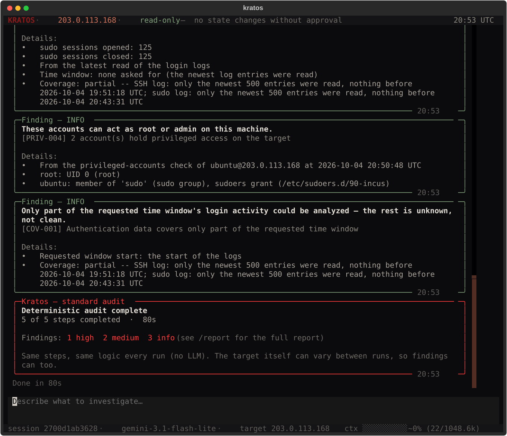
</p>

---

## The commands

You never *have* to memorize these — `?` lists them and `Ctrl+P` searches them —
but here's the map. Everything starts with `/`.

<p align="center">
  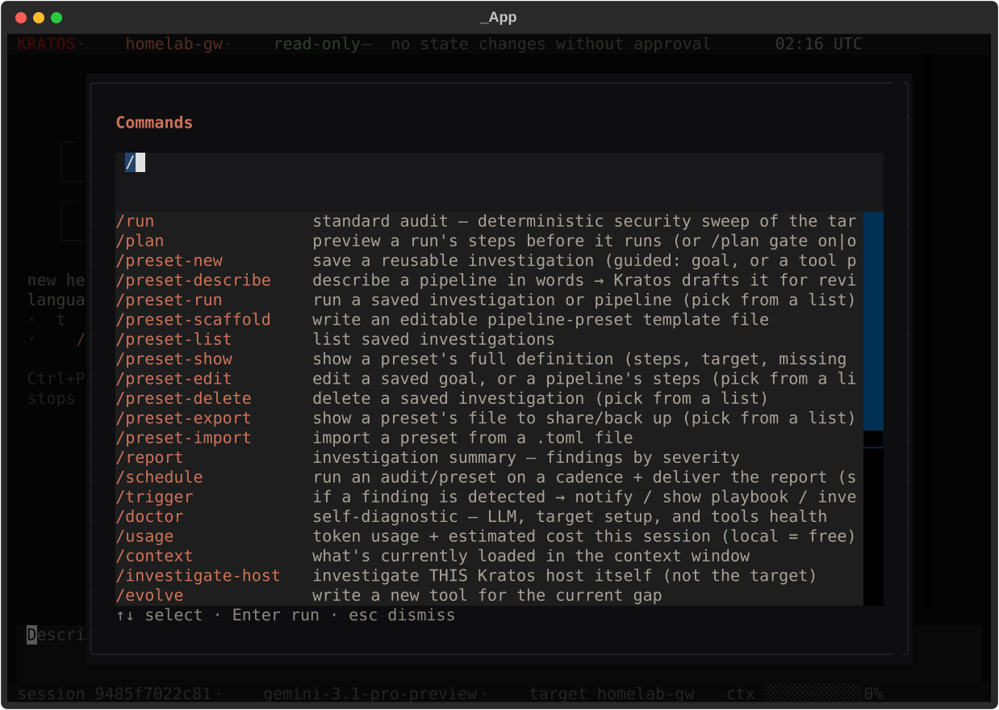
</p>

**Getting around**

| Command | What it does |
| --- | --- |
| `/guide` | the short, in-app version of this guide |
| `/help` or `?` | list every command |
| `/target <host>` | connect a machine to watch (and check its setup); `/target verify` re-checks; `/target link` changes how it's reached; `/target seal` keeps its journal-sealing key here (`/target seal verify` checks now) |
| `/sessions` (or `Ctrl+B`) | go back to the list of past sessions |
| `/rename <name>` | give this session a name |
| `/clear` | clear the screen (your history is kept) |
| `/reset` | start this session fresh (old history is archived, not deleted) |
| `/delete` | archive this session |
| `/exit` | leave |

**Investigating**

| Command | What it does |
| --- | --- |
| *(just type a question)* | Kratos investigates it, picking its own tools |
| `/run` | the standard fixed audit (no model steering) |
| `/plan` | preview exactly which steps a run will take; fixed audits show this preview and ask first by default (`/plan gate off` skips it) |
| `/report` | this session's findings: new, still open, fixed, not rechecked, hidden |
| `/findings` (or `/f`) | findings remembered across checks — verify, accept a risk, mark false positive or out of scope |
| `/detect` | the detection rules (SigmaHQ, with their authors): which run, on/off for this machine, what couldn't be checked, run them now — see [Detection rules](#detection-rules) |
| `/hunt <indicator>` | has this address, hash, account, domain, program or path been seen on your machines? Searches what Kratos holds and says what that covered — see [Hunting](#hunting-for-an-address-account-or-file) |
| `/investigate-host` | investigate the Kratos machine itself, not the target |
| `/use <tool>` | run one specific tool directly |
| `/tools` | list every tool Kratos can use, built-in and self-written |

**Building and reusing**

| Command | What it does |
| --- | --- |
| `/evolve` | build a new tool for something Kratos can't do yet |
| `/preset` | save an investigation to re-run later (`/preset new`, `list`, `run`, `show`, `edit`, `delete`, `export`, `import`) |
| `/preset-describe` | describe a pipeline in words; Kratos drafts it for you to review |
| `/schedule` | run an audit or preset automatically on a timer |
| `/trigger` | when a finding shows up: notify you, show a response playbook, or investigate it — optionally only when it's new, came back, or an acceptance expired |

**Checking and configuring**

| Command | What it does |
| --- | --- |
| `/doctor` | check that your setup (model, target, tools, vulnerability data) is healthy |
| `/collect` | check the basics now (ports, sign-ins, altered logs, accounts, vulnerable packages, configuration); `/collect all` adds the slow checks |
| `/usage` | tokens used and rough cost this session |
| `/context` | how full the model's memory is right now (`/compact` makes room) |
| `/trace` | what the last run did, step by step (`/trace list`, `/trace <id>`) — see [Run records](#run-records) |
| `/data` | what Kratos keeps on this computer and how big (`/data prune traces 90` removes old run records) — see [What Kratos keeps](#what-kratos-keeps) |
| `/model` | switch, add, or edit which model Kratos uses |
| `/settings` | models, tools, timezone, and this session's options |
| `/timezone` | show or set the timezone times are displayed in (stored times stay UTC) |
| `/subagent` | add and manage the agents on machines you can't SSH into |
| `/whitelist` | a sub-agent's allowlist for the experimental fix channel |
| `/run-fix` | send a recommended fix to a box's sub-agent, if it's allowlisted there |
| `Ctrl+T` | change the color theme |

---

## Questions about time

Ask about a period in normal words — *"in the last 24 hours"*, *"since Monday"*,
*"this week compared with last week"* — and Kratos works out the exact window and
shows it under the step that used it:

```
✓ measure_auth_activity  Measure auth activity
    window w1 last 24 hours: 2026-10-01 09:00 → 2026-10-02 09:00 (UTC) · counted in full
```

For logins and sudo use it doesn't read a sample of log lines and estimate: it
counts **every** matching event in that window on the target itself, and says
plainly when part of the window couldn't be covered (logs that were rotated away, a
machine that was off). If the target's clock is wrong, Kratos measures the offset
and corrects for it. Comparisons ("is this more than usual?") are worked out by
Kratos from the counts, not by the model.

<p align="center">
  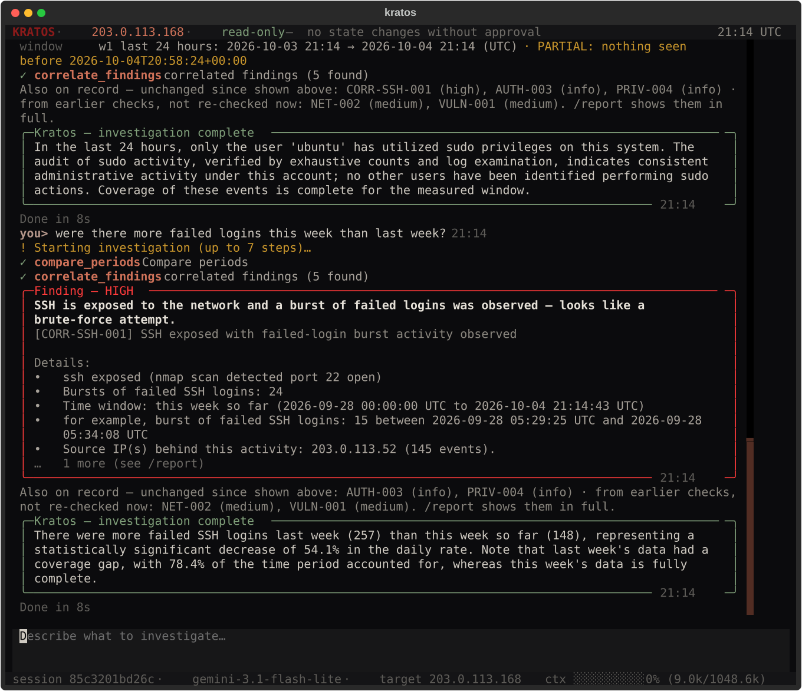
</p>

You can also ask what a machine looked like at a past time — *"was port 8080 open
last week?"*, *"who had sudo on Monday?"* — and Kratos answers from its own saved
scans, baselines and snapshots, telling you how close in time the nearest one is,
or that it has no record. It never fills the gap with a guess.

Times are shown in your timezone (`/timezone` to change it) and stored in UTC.

---

## Machines you reach through a sub-agent

Some machines can't take an SSH connection from Kratos: a VPS behind a provider
firewall, a box behind NAT, one where you'd rather not open port 22 at all. For
those, you install a small **sub-agent** on the machine. It connects *out* to
Kratos, so the machine opens no port, and it runs as a service so it survives
reboots.

<p align="center">
  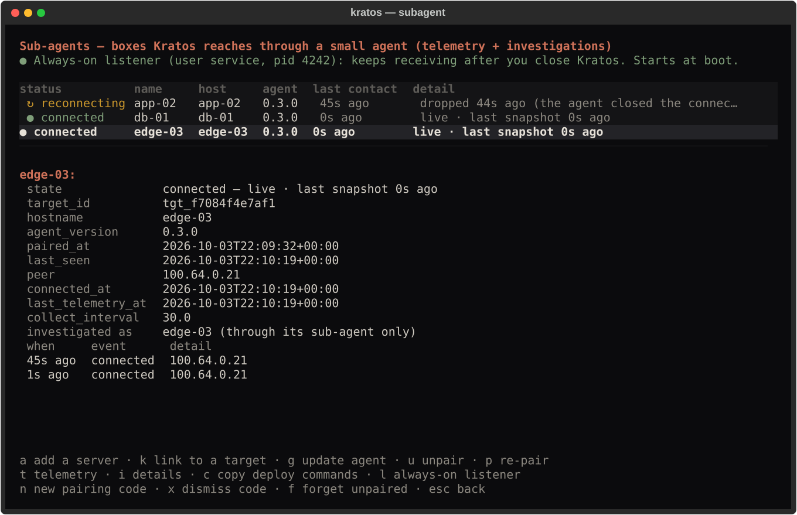
</p>

**Adding one.** Choose **Sub-agent** when you add a machine, or open `/subagent`
and press `a`. Kratos asks for a name and which address the machine should connect
to (your Tailscale address is listed first — it reaches a machine anywhere, without
opening ports), then writes a one-command installer. Run it on the machine
yourself, or let Kratos copy and run it over SSH for you once. Within seconds the
row turns **connected**.

**What it does from then on.**

- It streams the machine's status — uptime, disk, listening ports, hashes of
  critical files — every 30 seconds, whether or not you're investigating.
- Investigations read the machine through the agent's own fixed set of reads:
  logs and login activity, privileged accounts, processes, open files,
  configuration checks, file hashes, and YARA scans. Kratos never sends it command text, every request is
  signed, and a replayed request is refused. Each step says it was read through
  the sub-agent.
- Port and vulnerability scans need a direct network path from Kratos, so they're
  skipped for a machine reached only through its agent — and the answer tells you
  that part wasn't checked.
- YARA uses the rules on the machine itself (a starter set ships with the agent;
  add your own under `/etc/kratos-subagent/yara/`), scans common places like
  `/tmp`, `/home`, `/var/www` and `/opt`, never scans credential files (SSH keys,
  `.env`, shadow…), and reports which rule matched which file at which offset —
  never the matched text.
- **What that sends to Kratos.** A normal install runs the agent as root, so its
  reads see what root sees — more than an SSH login without `sudo` would: every
  process's open files, the whole system journal, and the sudo grant lines in
  `/etc/sudoers` (only the grants: settings lines and includes stay on the machine).
  Like everything an investigation reads, those results also go to your model
  provider. Choose sub-agent investigations for a machine knowing that.

<p align="center">
  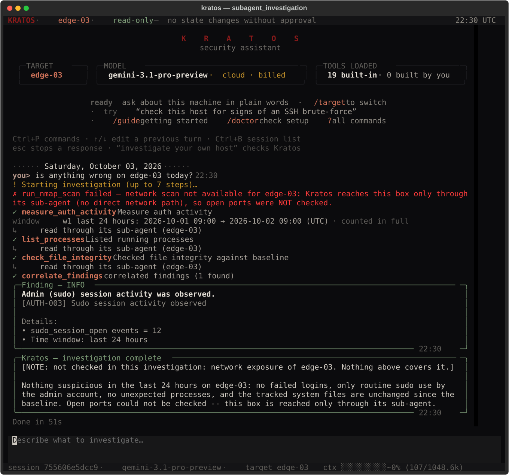
</p>

**Which machine is which.** Kratos never guesses. Choosing Sub-agent links the
machine to its agent once it checks in. If you later type an address that looks
like a machine you've paired, Kratos *asks* before linking. `/target link` switches
a target between **sub-agent only** and **SSH first, sub-agent if SSH can't
connect**; `/target verify` and `/doctor` show which way it's reached right now.

**Keeping it running.** The agents connect to a *listener* in Kratos. Opening
`/subagent` starts one inside the running Kratos; press `l` there to install it as
an always-on service instead, so status keeps arriving after you close Kratos. When
every paired machine reaches Kratos at an address of this computer, the service
listens only on those addresses (and on loopback); press `l` again after adding a
machine on a new address — `/subagent` reminds you. After you update Kratos, the
always-on listener restarts itself onto the new version once it's idle (within
about a minute; never in the middle of an investigation), so there's nothing to
restart by hand.

**Updating, unpairing.** When a newer Kratos ships a newer agent, `/subagent` marks
each machine still running the old one (its version shows `→ g`) and `/doctor` says
so too. Select it and press `g` to update its agent in place (it keeps its pairing).
Kratos never updates an agent on its own: that installs new code that runs as root
on the machine, so it waits for your keypress. `u` unpairs a machine, `k` links it
to a target, `i` shows details.

**The agent link is encrypted.** An agent installed or updated by this version of
Kratos talks to it over TLS, and it trusts exactly two keys: the one Kratos's
listener uses and a backup. Both are written into the installer, so the agent
knows them before it ever connects. Before the agent sends anything — its login,
a pairing code, a single status report — it checks that the server it reached
holds one of those two keys. Anything else in between (a proxy that decrypts
traffic, a fake listener, something that strips the encryption) gets nothing, and
the agent never falls back to an unencrypted connection. If that ever happens, the
agent's own log says "the server's key isn't the one this agent was given", and
the next time it reaches the real Kratos, `/subagent` (`i` on that machine) lists
how many such connections it refused and when. So the link is safe over any
network now, not just Tailscale; Tailscale is still the easiest way to *reach* a
machine behind NAT. Direct execution stays off either way.

- **Which machines are encrypted.** `/subagent` has a **link** column: *encrypted*,
  or *plain → g* for a machine still running an older agent. Until every machine is
  encrypted, the screen says which ones aren't; select each and press `g` to update
  it (it keeps its pairing, and its link is encrypted from then on). `/doctor` shows
  the same count, and `kratos subagent-tls status` lists every machine with the keys
  it holds.
- **Require encryption.** Once every machine shows *encrypted*, turn on **Agent
  link: require encryption** (Settings → General). From then on an old,
  unencrypted agent is turned away with "update the agent" instead of being let
  in. Kratos asks first if any paired machine isn't encrypted yet.
- **The keys, and why to copy the backup.** Kratos makes both keys the first time
  the listener starts, in the `subagent-tls` folder of your data folder (only you
  can read it; Kratos refuses to use the keys if anyone else can). The backup key
  isn't used yet — it exists so you can switch keys without touching any machine.
  Copy the whole `subagent-tls` folder somewhere safe together with your Kratos
  database backup. If both keys are lost, every agent has to be paired again
  (`/subagent`, `p` on each).
- **Switching keys.** `kratos subagent-tls rotate` makes the backup key the active
  one and makes a new backup. Within seconds the listener starts using it and sends
  the new pair to every connected machine. A machine that was off at the time still
  trusts the new key (it was its backup), so it reconnects by itself and then gets
  the new pair. Kratos won't rotate a second time while some machine still holds
  the old pair, because that machine would then trust neither key; let it connect
  once first.
- **Older agents** (before this version) still connect unencrypted until you update
  them or turn on "require encryption". For such an agent the old rules still
  apply: it treats the link as safe for investigations only over loopback or a
  Tailscale interface on its own machine (or one you named with
  `--trusted-interface` when you generated the installer), and refuses reads
  otherwise. The installer's old `--allow-untrusted-transport` option is ignored by
  an agent that has the keys.

---

## Building a new tool with /evolve

This is Kratos's most unusual feature, and it's built to be safe. If Kratos needs
a check it doesn't have, it can write one for itself — but only with your review.

Here's the whole flow:

1. **You give it an idea.** `/evolve` on its own uses a suggestion Kratos made — it
   makes one when an investigation hits something no tool covers, including when its
   own answer says it couldn't check something — or
   `/evolve "list which users can use sudo on the target"` starts from your words.
2. **Kratos writes a test first.** Every tool needs a small test that defines what
   "correct" means for it. Kratos can draft that test for you from your idea; you
   read it and can edit it. This test is the anchor — it's what keeps a
   self-written tool honest.
3. **Kratos writes the tool and runs the test in a sandbox.** The sandbox is a
   locked-down box with no network and no access to your files, so a
   work-in-progress tool can't do any harm while it's being checked. If the test
   fails, Kratos tries again a couple of times.
4. **You review and decide.** Kratos shows you the finished code, the test
   results, and a set of "things worth looking at" flags. Nothing is kept until
   you say yes. If you say no, nothing is saved.

<p align="center">
  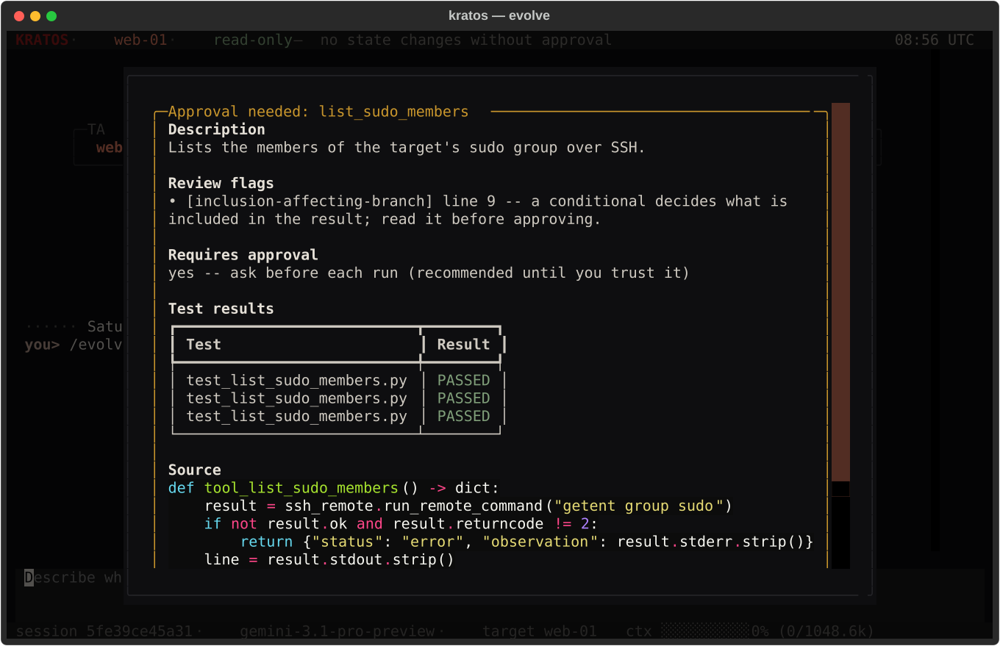
</p>

A kept tool becomes part of Kratos and runs on the real machine from then on —
which is exactly why the review step exists and why there's no way to skip it.
By default a new tool asks you before each run until you trust it; you can change
that later in Settings.

The first time you run `/evolve`, Kratos shows a short explainer of all this
before it starts. `/evolve help` brings it back any time.

---

## Saving and repeating work

If you find yourself running the same investigation often, save it.

- **Presets** save an investigation so you can run it again with one command.
  `/preset new` walks you through it; `/preset list` shows what you've saved; a
  saved preset also gets its own `/<name>` command.

  <p align="center">
    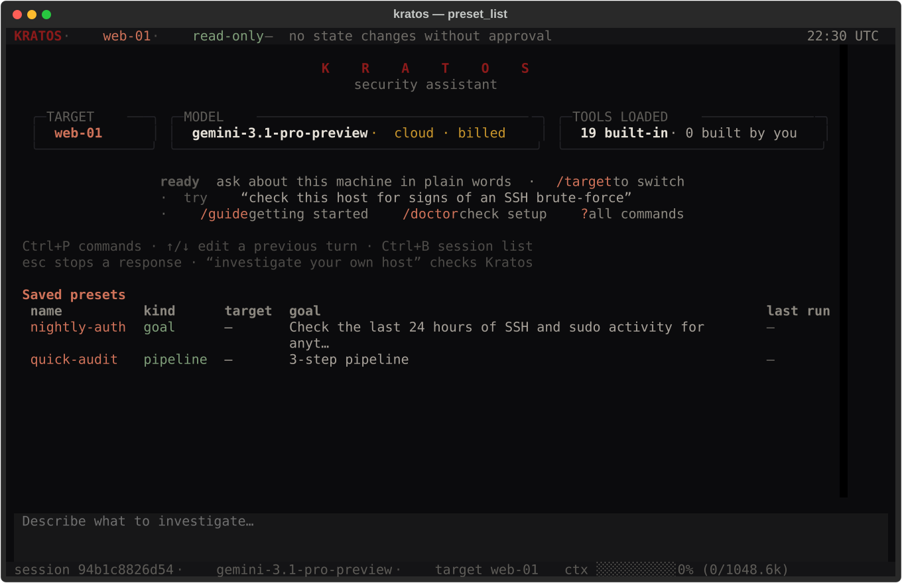
  </p>

- **Pipelines** are a fixed sequence of read-only tools you build once and re-run
  for a deterministic sweep — no model, same steps every time.
- **Schedules** run an audit or a preset automatically on a timer (say, every
  night) and can deliver the report. Kratos writes out the timer for you to
  install; it never installs system services on your behalf. If a scheduled run
  will use a cloud model, Kratos warns you first, because it costs money each time.

  <p align="center">
    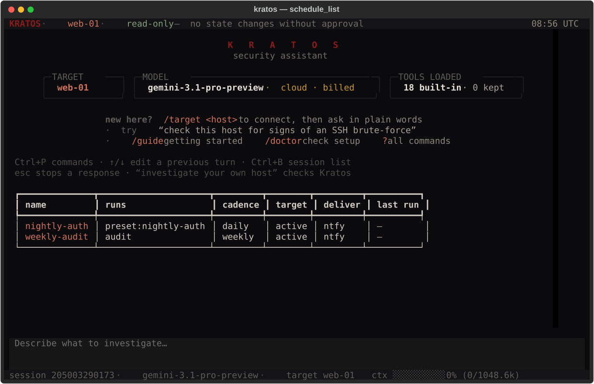
  </p>

- **Triggers** watch for a kind of finding and react — for example, send a
  notification when anything high-severity turns up. `/trigger test <name>` shows
  what a trigger would do, using an example finding, without sending anything.

  <p align="center">
    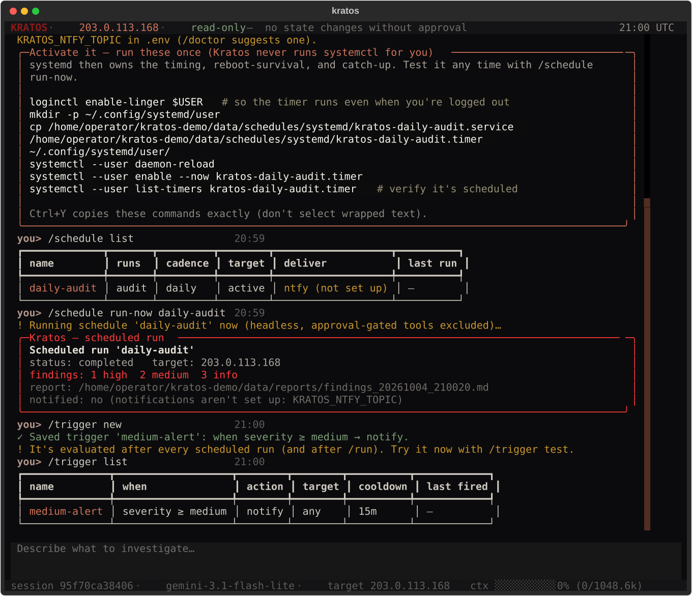
  </p>

### Getting alerts on your phone

Alerts are sent through [ntfy](https://ntfy.sh), a free push-notification
service, and they're **off until you turn them on**:

1. Run `/doctor`. The "notifications" line suggests a random topic name, like
   `KRATOS_NTFY_TOPIC=kratos-3f9c…`.
2. Add that line to your `.env` file and restart Kratos.
3. Install the ntfy app and subscribe to the same topic name.

One thing to know: an ntfy topic has no password. **Anyone who knows the topic
name can read every alert sent to it**, and alerts include your findings. That's
why Kratos never comes with a topic filled in, and why the suggested one is long
and random. For anything beyond trying it out, run your own ntfy server (set
`KRATOS_NTFY_BASE_URL`) or use an ntfy access token (set `KRATOS_NTFY_TOKEN`).
Until a topic is set, schedules still save their reports on disk; they just
don't send them anywhere.

**What an alert says.** A trigger's alert starts with the worst finding, the machine (by its
sub-agent name when it has one) and what happened in plain words — for example *HIGH on db-01
(10.0.0.5): Account added to a privileged group*. Then one line per finding (up to 5, then
"+N more"), when it happened, and what to do next: *open Kratos and type `/findings`*. The
trigger's name, the finding ids and rule credits come last. An alert never names accounts,
addresses or file paths (it may pass through a public ntfy server): `/findings` has those.

Each scheduled alert starts with what changed since last time (*New · Still open ·
Fixed · Hidden by your decisions*) and names any risk acceptance that ran out. A
trigger can be told to fire only for findings that are new, came back, or whose
acceptance expired — so a problem you already know about doesn't page you every
run.

---

## Keeping model costs under control

A hosted model charges for every question Kratos asks it, and some of those
questions are asked while nobody is watching: schedules, triggers and other
programs talking to Kratos over MCP. So Kratos counts every model call and stops
before it spends more than you allow.

**What's counted.** Every call to the model, from every part of Kratos: your
investigations and chats, plan previews, drafting pipelines, building tools
with `/evolve`, `kratos investigate` on the command line, scheduled runs, trigger
investigations and MCP calls. Each one is written down with how many tokens it
used and roughly what it cost. Costs are **estimates** from list prices (or the
exact figure, if your provider reports one) — your provider's bill is the real
number. A model you run yourself costs nothing, but its token limits still
apply, because a run that loops wastes time and power too.

**The limits, and their starting values:**

| Limit | Starts at | What it stops |
| --- | --- | --- |
| Daily budget, everything | $2.00 a day | all spending, you included |
| Daily budget, unattended runs | $0.50 a day | schedules, triggers and MCP together |
| Model calls per run | 40 | one investigation or chat turn that loops |
| Tokens per run | 300,000 | one run that grows out of control |
| Daily tokens, local or unpriced models | 3,000,000 | a model with no price on file, or your own |
| Fires per trigger per day | 10 | a trigger that keeps firing |
| Triggers may start investigations | off | each trigger investigation costs money |

"A day" is your local day (the timezone Kratos shows times in). A limit of `0`
means nothing is allowed for that scope; there is no "unlimited" — if you want a
lot, type a large number on purpose. The starting values are chosen so a normal
day of use never reaches them, while a run that loops or a trigger that fires
hundreds of times does.

**Changing them.** Open Settings (`/settings`, or `s` at the session picker),
move to the **Budget** tab with `ctrl+→`, pick a limit with ↑↓ and press Enter.
Each row shows what has been used today. A change applies from the very next
model call, in every Kratos window and in scheduled runs. The same tab lists the
prices Kratos estimates with (correct them, or add one for your model) and any
paused sources. The first time you create a schedule or a trigger, Kratos shows
these limits once and lets you keep them, edit them or cancel.

On a machine without the app open (schedules, `kratos mcp-serve` on a server), use
the command line instead — same limits, same checks:

```bash
kratos budget
```

```bash
kratos budget set daily_cost_usd 5
```

`kratos budget` shows today's spending and every limit; `kratos budget set NAME
VALUE` changes one (`on`/`off` for the yes/no ones); `kratos budget resume SOURCE`
ends a pause early.

**What happens at a limit:**

- **While you're using Kratos**, it asks: *"This would go over today's model
  budget ($2.00, used $1.94). Continue this run anyway?"* Press `y` to let this
  one run continue (your answer is recorded); anything else stops it. An
  investigation that stops this way says so — "stopped by budget" — and still
  shows what it had checked and found so far. On the command line the same
  question is asked in the terminal; with no terminal (a cron job, a pipe) the
  answer is no.
- **Schedules, triggers and MCP** are never asked — nobody is there. A scheduled
  run that would go over doesn't start; it saves a "refused by budget" result and
  notifies you, so silence never means "all clear". One that reaches a limit
  midway stops at the next step and reports what it found.
- **Triggers** stop firing for the rest of the day once they reach their fire
  limit, and tell you once. A trigger set to *investigate* only notifies until you
  turn on **Triggers may start investigations**, and its alert says how. (If you
  already had an investigating trigger before these limits existed, Kratos turned
  that setting on for you once and told you.)
- **Warnings come first.** At 80% of a daily limit Kratos shows one warning line
  and sends one notification; when you're within 10% of a limit, the bottom bar
  of the conversation says so.
- **Something that keeps failing gets paused.** If a schedule, triggers or MCP
  runs fail or loop 5 times within an hour, Kratos pauses that source for two
  hours and tells you once. Resume it early from the Budget tab. Your own use is
  never paused — you just get a warning.

`/usage` shows today against every limit and what this session has used;
`/doctor` has a **budget** line with today's spending and anything paused.

---

## Keeping an eye on things

- **`/doctor`** is your "is everything OK?" button. It checks the model
  connection, your settings, the target, and the tools, and tells you the fix for
  anything that's wrong.

  <p align="center">
    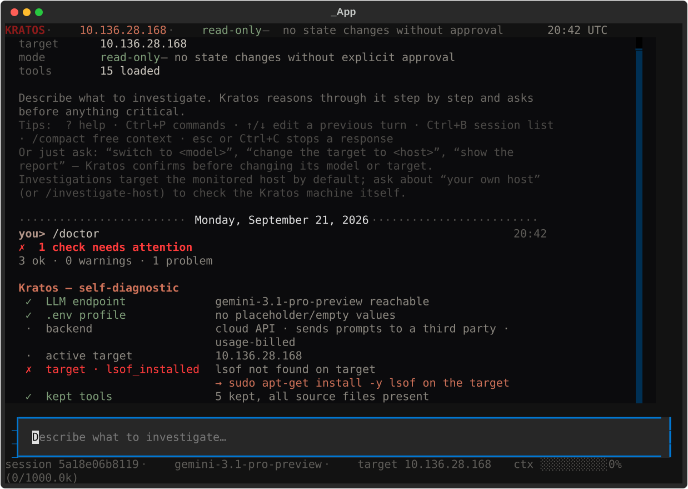
  </p>

- **`/usage`** shows today's spending against your limits, then how many tokens
  this session has used and a rough cost, per model, counting every time you've
  opened the session (it's saved with it). With a local model it's free and says
  so. See [Keeping model costs under control](#keeping-model-costs-under-control).

  <p align="center">
    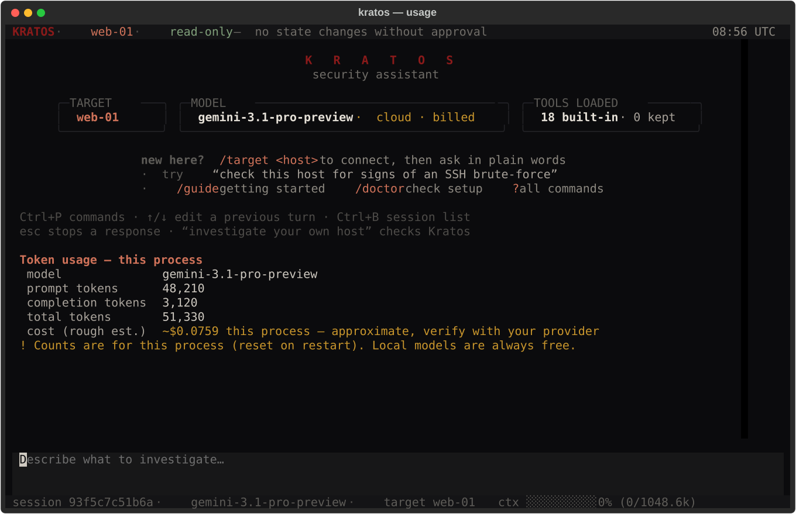
  </p>

- **`/context`** shows how full the model's short-term memory is. When it gets
  full, `/compact` summarizes the older parts to make room while keeping the
  important points.

  <p align="center">
    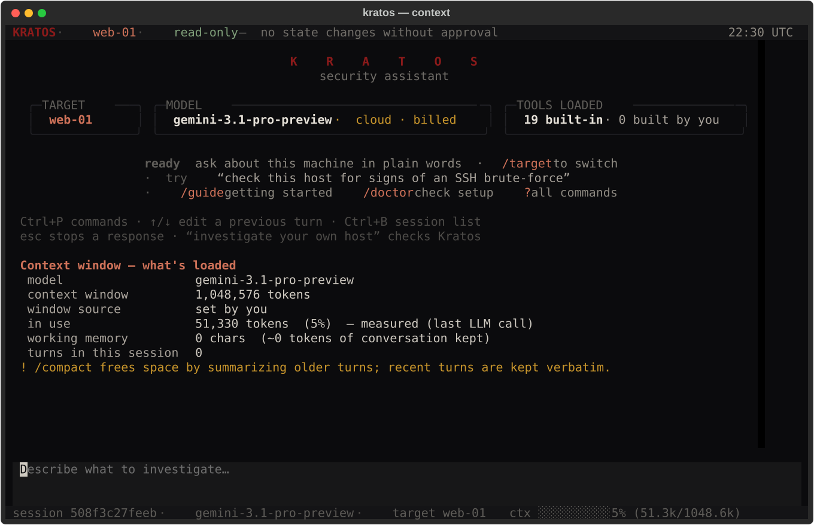
  </p>


---

## What Kratos keeps

Everything Kratos learns stays on this computer, in its data folder (`/doctor`
shows where). **Kratos never deletes any of it on its own** — not old
conversations, not log lines, not findings, not run records. How much to keep is
your choice.

`kratos data` (or `/data` in the app) lists every kind of stored data: what it
is, where it lives, how big it is, the oldest and newest, and whether it is
**personal data** — names of your machines, usernames and addresses from their
logs, the questions you asked. `kratos data -v` adds the exact files and tables.
`/doctor` shows the total in one line.

| Kind | Personal? | What's in it |
| --- | --- | --- |
| Sessions and conversations | yes | your questions, the answers, each turn's steps |
| Run records (traces) | yes — **the most detailed** | every model call, tool call and result, guard, and how each answer was built |
| Host events | yes | the log lines Kratos read from your machines |
| Findings and decisions | yes | what was found, its history, your accept/ignore decisions, reports |
| Collected snapshots | yes | port scans, logs, processes, packages, persistence, each machine's account list — what each check read |
| Hunts | yes | each hunt: when, who, what was hunted (the address or account you typed), which machines and period, how many matched ([Hunting](#hunting-for-an-address-account-or-file)) |
| Placeholder map (masking) | yes | which placeholder stood for which real name or address in each conversation ([What the model sees](#what-the-model-sees)) |
| Chat-client server | yes | chat-app tokens (only a hash of each), which session holds each chat, one audit row per request ([Using Kratos from a chat app](#using-kratos-from-a-chat-app)) |
| Sub-agent pairing and telemetry | yes | paired machines and their live status |
| Sub-agent installer scripts | **secret** | an install script holds a one-time pairing code |
| Journal seal keys | **secret** | the keys that verify a machine's sealed journal |
| Budget ledger, log-sync positions, collection bookkeeping | no | counts, times and positions |
| Vulnerability data, threat-intel cache, vulscan CVE list | no | public data, downloaded |

Two things are kept on a rolling basis rather than forever, and the list says
so: a sub-agent's live status keeps its newest 500 telemetry readings and 200
connection events per machine, and an unused pairing code is removed a week
after it expired.

**Removing old data yourself.** Every prune shows what would go first:

```bash
kratos data prune --category traces --older-than 90d
```

That prints how many run records (and how many MB) are older than 90 days and
deletes nothing. Add `--apply` to remove them. The same works for `sessions`
(old questions and answers, with their transcript files and placeholder maps),
`host_events` (old log lines, with their entries in the hunt's index), `hunts` (old hunt
records) and `pseudonyms` (placeholder maps of old runs that
had no conversation, and of conversations already removed). In the app, `/data prune traces 90` shows the same summary and asks
before deleting. If other data depends on what you remove — for example Kratos
says it holds a period of a log completely, and you're deleting those lines —
the prune says so and stops; `--force-orphans` removes the dependent part too.
`kratos data history` lists every prune you've run. Old snapshots have their own
command, `kratos snapshots prune`, which thins them (keeps one a day, then one a
week, then one a month) and never removes the newest of each.

## Run records

Every investigation, `/run` audit, pipeline preset, scheduled run and trigger
leaves a **run record** (a trace): one file per run in the data folder's
`traces/` folder. It holds what the run actually did:

- every model call — which model, tokens in and out, cost, how long it took;
- every tool call — the arguments it got, whether you were asked to approve it
  and what you said, its result (up to 256 KB; a bigger one keeps its start and
  a fingerprint of the whole), how long it took;
- every check Kratos ran by itself before the model started, and whether it was
  reused, ran, or finished in the background;
- every time an answer check sent an answer back or added a NOTE;
- how the final answer was put together: which findings Kratos listed at the
  top, the NOTEs it added, how long the model's own text was.

```bash
kratos trace list
kratos trace show 3f2a91c0
```

`kratos trace show` takes the first few characters of a run's id (the end of an
investigation prints it; `kratos trace list` lists them) and prints the steps as
a tree with the totals. `--json` prints the whole record. In the app, `/trace`
shows the last run of this session. A scheduled run that started a trigger
investigation lists it under "Runs started inside this one".

A run record holds everything the run read — it is the most detailed file Kratos
writes, so treat it like the logs themselves. Text in it from your machines is
shown safely (like everywhere else); the file keeps the original. Settings →
General → Run records: turn them off, change the size kept per result, or keep
the full text sent to the model as well (off by default).

**Sending run records to your own tools (optional).** If you run an
OpenTelemetry collector (Jaeger, Grafana Tempo, Phoenix, ...), Kratos can send a
copy of each run there. Install the extra and point it at your collector:

```bash
pip install 'kratos[otel]'
```

```bash
export OTEL_EXPORTER_OTLP_ENDPOINT=http://127.0.0.1:4318
```

Then turn on Settings → General → "Copy to your OpenTelemetry collector". What is
sent: the steps' names and timings, token counts and cost, model and tool names,
guard names and finding ids. **What is never sent:** tool arguments and results,
anything sent to the model, your question, machine names. Nothing is sent unless
both the setting is on and that address is set. If the collector is down, the run
is not affected — Kratos logs it once and the local record is still written.

---

## Using Kratos from the command line and other tools

Everything starts from `kratos`, but a few things work without the full-screen UI:

| Command | What it does |
| --- | --- |
| `kratos investigate "<goal>"` | one investigation, printed to the terminal |
| `kratos run` | the standard fixed audit |
| `kratos doctor` | check your setup (model, target, tools, data) from the terminal — the same checks as `/doctor`, plain text; exits non-zero if something failed |
| `kratos scheduled-run <name>` | run one saved schedule (what the installed timers call) |
| `kratos subagent-install` | write a sub-agent installer from the command line |
| `kratos subagent-serve` | run the sub-agent listener in the foreground |
| `kratos subagent-status` | list paired machines and whether they're connected |
| `kratos mcp-serve` | start the MCP server (below) |
| `kratos serve` | the chat-app server: Kratos as a model in Open WebUI or any OpenAI-compatible app, plus MCP over HTTP; `token create/list/revoke`, `status`, `set` ([Using Kratos from a chat app](#using-kratos-from-a-chat-app)) |
| `kratos collect` | check the basics on a machine now (`--all` adds the slow checks, `--force` re-runs fresh ones) |
| `kratos events` | show the log lines Kratos has read from a machine (below); `--coverage` shows which stretches are complete |
| `kratos findings` | list remembered findings and record your decisions ([Keeping track of findings](#keeping-track-of-findings)) |
| `kratos attack-layer` | write an ATT&CK Navigator file of what Kratos can detect, or (`--observed`) what its open findings show ([The ATT&CK line](#understanding-findings)) |
| `kratos budget` | model spending limits: show today's spend, `set NAME VALUE`, `resume SOURCE` ([Keeping model costs under control](#keeping-model-costs-under-control)) |
| `kratos trace` | run records: `list` recent runs, `show ID` one run's model calls, tool calls, checks, guards and answer ([Run records](#run-records)) |
| `kratos data` | what Kratos keeps on this computer, how big, personal or not; `prune` removes old data (preview first), `history` lists prunes ([What Kratos keeps](#what-kratos-keeps)) |
| `kratos vulndb-update` | download the package-vulnerability data and rebuild the local index (`--status`, `--about`, `--ecosystems`) ([Vulnerable packages](#vulnerable-packages)) |
| `kratos seal` | journal sealing: `set-key HOST` (reads the key from what you paste, never the command line), `status`, `verify HOST`, `remove-key HOST` |

`kratos --help --all` lists every subcommand. Without a session, these use the
default target Kratos saved the first time you set one (or `KRATOS_SSH_HOST`).

**The log lines Kratos keeps.** Every log line Kratos reads while investigating —
logins, sudo use, account changes, programs run, cron jobs, service changes,
firewall blocks, package installs, web requests, other system log lines — is kept as an *event*
in `kratos.db`, in your data folder. This stored copy stays on this computer (it is
never sent to the model or anywhere else), and Kratos never deletes it, so the file grows with use (roughly
1 GB per million lines). Passwords, tokens and keys that appear in a log line
are blanked out before it's kept. To see them:
`kratos events --target 10.0.0.5 --since "1 hour ago"` (add `--ip`, `--user`,
`--process` or `--action ssh_failed_login` to narrow it down, `--json` for the full
records). To delete them, for example everything older than 90 days, close Kratos
and run:
`sqlite3 ~/.local/share/kratos/data/kratos.db "DELETE FROM host_events WHERE ts < strftime('%s','now','-90 days');"`
(in a source checkout the file is `data/kratos.db` instead).

**MCP.** `kratos mcp-serve` (stdio; for MCP over HTTP see [Using Kratos from a chat app](#using-kratos-from-a-chat-app)) lets other AI tools that speak the
[Model Context Protocol](https://modelcontextprotocol.io) — Claude Desktop,
OpenWebUI and others — ask Kratos to investigate a machine, fetch a session's
findings, list sessions, and send a notification built from real findings. It's
read/investigate-only on purpose (`kratos_finding_states` reads finding states;
nothing over MCP can change one): every tool that would need a yes/no from you is
left out, and the other tool never picks Kratos's internal steps — Kratos's own
loop does, with all its checks.

---

## Using Kratos from a chat app

`kratos serve` lets you talk to Kratos from the chat app you already use —
Open WebUI, LibreChat, AnythingLLM, or anything that speaks the OpenAI API. In
the app, Kratos is a **model named after a machine**: pick `kratos/web-01` and ask
"has anyone been trying to log in?". Kratos investigates **web-01** — the machine
comes from the model you picked, never from the words in your message — with the
same checks, answer checks, masking and spending limits as in the Kratos app.

It is meant for **your own** chat app. Several people sharing one Open WebUI
through one Kratos isn't supported yet: there are no per-person permissions or
budgets.

### Setting it up

1. **Make a token** for the chat app. It is printed once; Kratos keeps only a
   hash of it.

   ```bash
   kratos serve token create --name owui --targets 192.0.2.10,192.0.2.11
   ```

   `--targets` lists the machines this token may investigate (each becomes a
   model). Without it, the token reaches only your default machine. Add `--mcp`
   if an agent host should use the MCP door too.

2. **Start the server.** It listens on `127.0.0.1:8770` — this computer only:

   ```bash
   kratos serve
   ```

   (8770, not 8765: that one is the sub-agent listener's.) `kratos serve status`
   says whether it's running; `/doctor` shows a "chat server" row.

3. **Add the connection in your chat app.** In Open WebUI: *Admin Settings →
   Connections → OpenAI → +*, URL `http://127.0.0.1:8770/v1`, the token as the
   API key. The models `kratos`, `kratos/192.0.2.10`, … appear in the model list.
   If Open WebUI runs in Docker, start it with `--network host` (or point it at
   an address of this machine the container can reach, and see *Remote access*
   below).

Settings that help in Open WebUI (environment variables of the Open WebUI
container):

| Variable | Why |
| --- | --- |
| `ENABLE_FORWARD_USER_INFO_HEADERS=true` | Open WebUI then sends the chat's id, so each chat in Open WebUI is one Kratos session (follow-up questions keep their context). The user name it sends is written to Kratos's audit log only — never used for permissions. |
| `AIOHTTP_CLIENT_TIMEOUT=900` | Open WebUI gives up on a reply after 300 s by default; a slow investigation can take longer. |

Open WebUI also asks the selected model for a chat title and tags after each
message. Kratos answers those itself without calling its model ("Kratos chat"),
so they cost nothing.

### What you see

- **While it works**, the "thinking" panel shows what Kratos is doing:
  "collecting the basics…", "checked ports: ok", "running read_host_logs". These
  lines are Kratos's own; the model's draft is never streamed, because an answer
  check can still send it back.
- **The answer** is the checked answer — the same one the app shows: Kratos's
  *found* list (written by Kratos, with each finding's verdict), its notes, then
  the model's analysis, then any suggested commands, each labelled with where it
  came from (Kratos's template or the model) and any warnings above it. Kratos
  never runs them.
- **Text from your machines can't do anything in the chat.** Chat apps render
  Markdown, and a log line could carry an image that loads the moment it's shown
  (leaking whatever its address carries) or a link. Kratos shows anything it quotes
  from a machine as inert code text, removes images from the model's analysis,
  shows links and addresses as plain text in the usual "defanged" form —
  `hxxps[:]//example[.]com/...` — and escapes HTML. To keep links to sites you
  trust clickable, list them: `kratos serve set serve.link_hosts ubuntu.com,nvd.nist.gov`.
  (Your own message is rendered by the chat app itself: an image you type there
  is loaded by the app, not by Kratos.)
- **The stop button** stops the investigation before its next model call or
  tool call; checks already running finish (they only read), nothing new starts.
  The turn is saved as stopped.

### What works in a chat — and what doesn't

These work without using the model: `/findings` (open findings for the
machine), `/usage` (today's spending), `/retest <key>` (re-collect and re-check a
finding), `/hunt <indicator>` (search what Kratos holds — only on the machines this
token may see; it takes a slot and counts in the hourly limit like `/retest`), `/help`. **Not available from a chat app** — use the Kratos app:
`/evolve`, `/whitelist`, `/run-fix`, accepting or dismissing findings, settings,
target setup, presets, and anything that would ask for your approval. Tools that
could stop to ask you are left out of investigations started from a chat app, so
nothing there can change a machine.

### Limits and spending

Investigations from a chat app count as **unattended** runs (like schedules and
MCP): `budget.unattended_daily_cost_usd` applies, and when a limit is reached the
chat reply says which one. On top of that:

| Setting | Default | |
| --- | --- | --- |
| `serve.max_parallel` | 2 | investigations (and `/retest`s, which re-read the machine) at once; more wait ("waiting for another investigation to finish…") |
| `serve.requests_per_hour` | 30 | messages that use the model or re-read the machine (`/retest`), and MCP investigations, per token per hour; requests still running count too, so several sent at once can't slip past it. Other commands and the app's title requests don't count |

Kratos answers up to 16 chat messages at once (running or waiting for a slot); past that a
new message gets a "Kratos is busy" reply (HTTP 429) to retry shortly, and the server keeps
answering everything else.
| `serve.port` | 8770 | |

Change them in *Settings → General* or with `kratos serve set serve.max_parallel 3`.

### MCP over HTTP

A token made with `--mcp` can also use `http://127.0.0.1:8770/mcp`
(Streamable HTTP, bearer token). Its tools, all limited to the token's machines:

- `kratos_start_investigation(goal, target, wait_seconds)` — starts one and
  returns its id; with `wait_seconds` (up to 120) it waits and returns the
  checked answer as soon as it's done (most take 5–30 s), so a client that makes
  one tool call per turn still gets the answer.
- `kratos_get_investigation(investigation_id, wait_seconds)` — progress lines, then
  the checked answer and findings. Leave the id empty for your newest one.
  Investigations are still found after `kratos serve` restarts (one cut off by the
  restart says `interrupted`).
- `kratos_get_findings`, `kratos_list_sessions`, `kratos_finding_states` — read only.
- `kratos_hunt(indicators, kind, since, until, machine)` — read only: the same hunt as
  `/hunt`, over this token's machines only, with its plain-words `report` (what was
  searched included). It counts in the hourly limit.

In Open WebUI: *Admin Settings → External Tools → +*, type **MCP (Streamable
HTTP)**, the URL, auth **Bearer** with the token; then turn the Kratos tools on
for a model under *Workspace → Models*. **With Gemini models set that model's
*Function Calling* to *Legacy*** (Advanced Params): Gemini's OpenAI-compatible
endpoint streams tool calls without the `index` field Open WebUI 0.12 needs, so in
the default (native) mode Open WebUI silently drops the call and the reply is
empty. Ask it to use `wait_seconds` ("start an investigation of web-01 with
wait_seconds 90").

Note that in this mode the chat app's own model reads Kratos's result and writes
its own reply: in our test it kept the finding, the attacker's address and the
commands but dropped Kratos's note about what it could not check and the verdict.
Use the model connection above when you want Kratos's checked answer itself as
the reply.

### Remote access

Keep `kratos serve` on `127.0.0.1` unless you need the chat app on another
computer. If you do, put a TLS reverse proxy in front — never send tokens over
plain HTTP across a network. With Caddy on the Kratos machine:

```
kratos.example.internal {
    reverse_proxy 127.0.0.1:8770
}
```

and tell Kratos the name the proxy uses: `kratos serve set serve.allowed_hosts
kratos.example.internal`. (Kratos refuses requests whose Host header it doesn't
expect, so a web page can't reach your local server through a name it controls.)
Listening on another address directly needs both `kratos serve --host <address>`
and `kratos serve set serve.allow_non_loopback yes`, and Kratos warns that tokens
then travel in clear text.

### Tokens and the audit log

`kratos serve token list` shows each token's machines, doors and last use (never
the token). `kratos serve token revoke owui` stops it on the next request. After
ten wrong tokens in a minute from one address, that address is refused for a
while -- except requests carrying one of your live tokens, which are still checked: behind a
reverse proxy every client shares one address, and a stranger's guesses must not lock you out. Every request is recorded in the audit log in `kratos.db`
(`serve_audit`): time, token, door, model and machine, the client's address, the
user name the app forwarded, the run it started, how it ended (ok, refused,
stopped, error, budget) and how much was sent back — never your message; that is
in the session. Nothing in it is deleted automatically.

---

## The experimental fix channel

Everything above is observe-and-recommend: Kratos tells you what to run, and you
run it. There is one experimental exception, and it is **off for every machine**.

With a sub-agent on a machine, Kratos can carry out a small set of allowlisted
fixes there — for example "ban this IP in fail2ban" or "enable and start this
service". `/whitelist` shows each machine's allowlist: which actions are on, how
risky each is, and what the machine's own agent will accept.

<p align="center">
  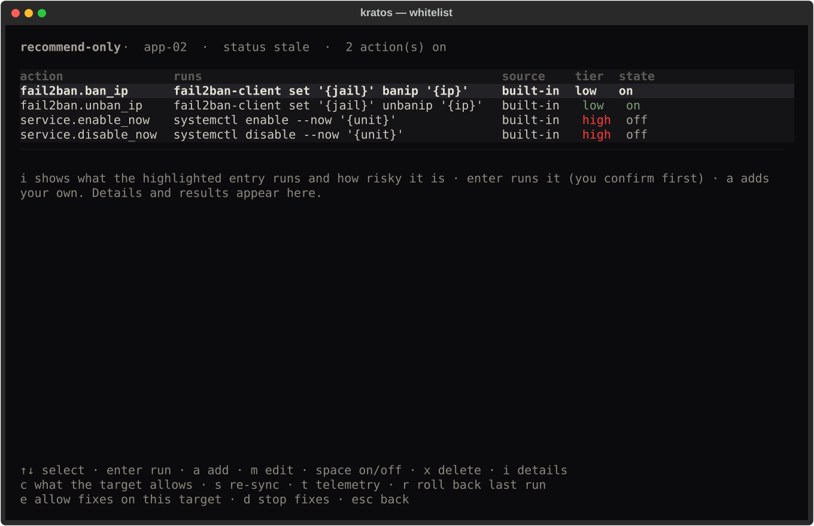
</p>

Here is the whole thing on one machine — turning it on, running a fix, and undoing
it. Until it's turned on, `EXECUTE` only shows you the command to run yourself:

<p align="center">
  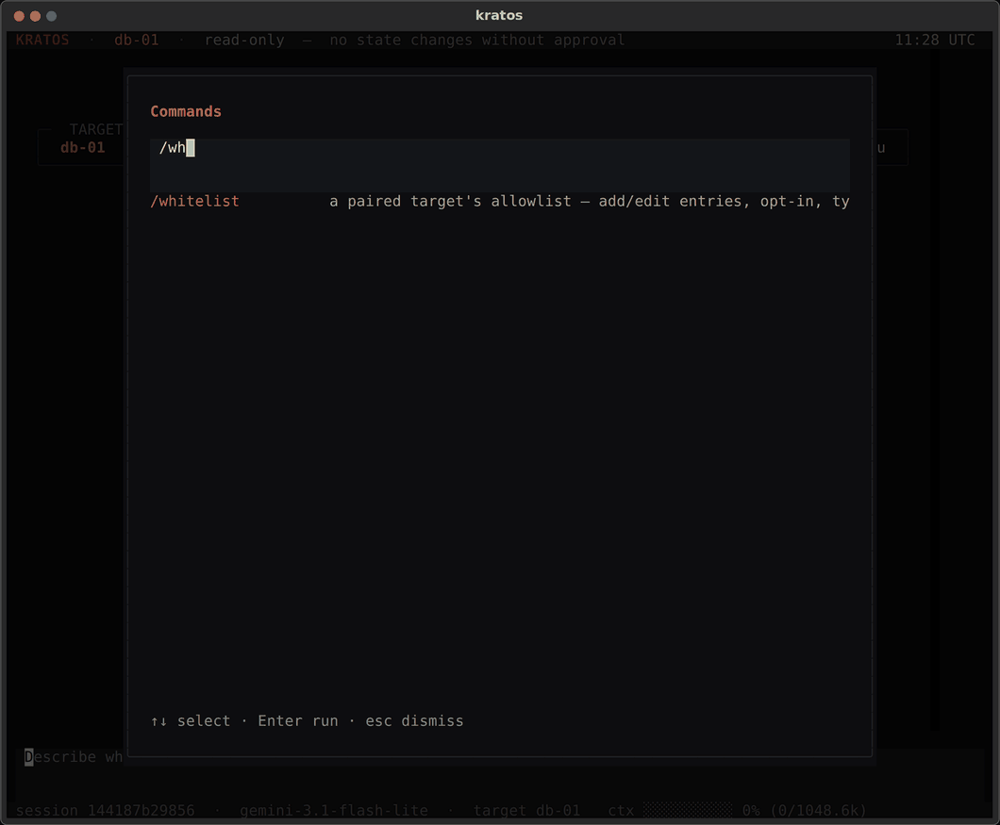
</p>

What has to be true before anything runs:

1. The agent on that machine was started with execution switched on. That's a
   setting on the machine itself; the installer never sets it. The machine has
   the last word: its agent refuses every run unless it was started with
   execution on. It tells Kratos which way it's set, so `/whitelist` warns you up
   front and its approval screen only shows the command to run yourself.

<p align="center">
  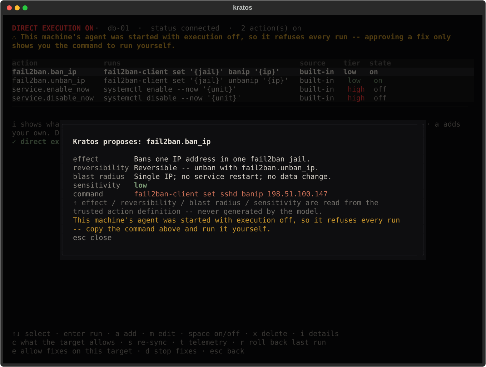
</p>

2. You've given consent for that machine in `/whitelist` (it explains the risk
   first, in plain language, and is reversible any time).

<p align="center">
  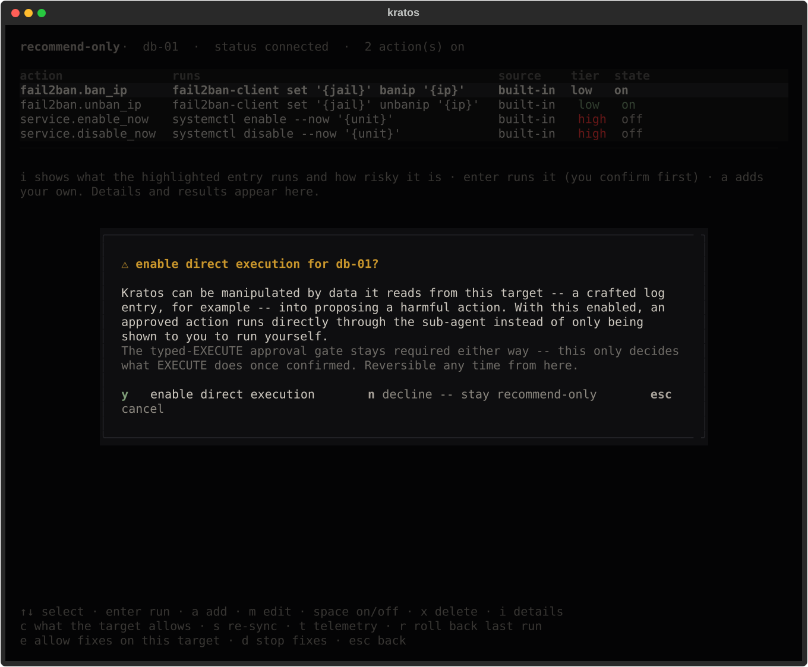
</p>

3. The action is on in that machine's allowlist. The agent carries its own fixed
   list of exactly which programs and arguments it will ever run; Kratos can
   narrow that list, never widen it. Exact commands beyond it can only be added by
   the machine's own administrator, in a root-owned file on the machine
   (`/etc/kratos-subagent/allowed-commands`). A line there is trusted exactly as
   written: it can do whatever that program can do, including touching files the
   built-in actions never may — only shells, script interpreters and programs that
   run another command are refused. Treat that file like `sudoers`. Press `c` to see
   exactly what that machine's agent will accept.
4. You type `EXECUTE` for that run, and a high-risk action asks a second time.
   Every field on that screen — what it does, how it's undone, what it can affect —
   is read from the trusted action definition, never written by the model. After an
   investigation recommends a fix that matches an allowlisted action, `/run-fix`
   opens that same confirmation, pre-filled. (In this picture the recommended ban was
   supplied for the demo: the lab's attacker has a private address, which the
   allowlist rightly refuses to ban.)

<p align="center">
  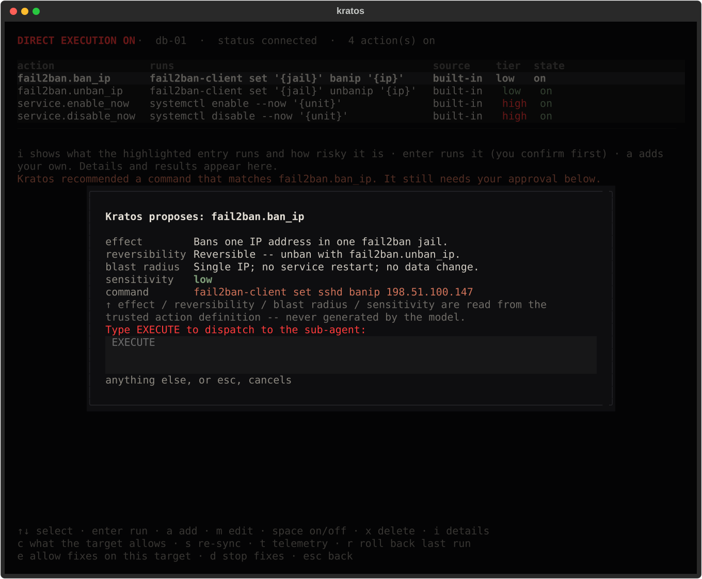
</p>

A run is sent at most once, only if consent is still on at that moment, and only
within 30 seconds of your `EXECUTE`. If no listener picks it up in that time, Kratos
cancels it and tells you nothing ran — it can never run later, when a listener
happens to start. "Outcome unknown" means the run was sent but no answer came back:
check the machine before trying again.

If a machine has already applied a newer allowlist than Kratos's own copy (for
example after you restored Kratos's data from a backup), it refuses Kratos's updates
and `/whitelist` says so; press `s` there to catch up.

After a reversible change runs, `t` shows the machine's latest telemetry and whether
it confirms the change: the machine sends a new snapshot about every 30 seconds, and
Kratos tells you when the one it has is from before your run. For a medium- or
high-risk action, `r` rolls the change back through the matching inverse action,
behind the same typed-`EXECUTE` gate.

**An independent security review (October 2026) found no way past the agent's
allowlist; the issues it did find are fixed, and a follow-up review of those fixes
is planned. Until then, don't turn it on for a machine you care about.** Leaving it off costs you nothing: every
recommendation still comes with the exact command for you to run.

---

## Making it yours

Press `Ctrl+T` (or open `/settings`) to change the color theme. Kratos comes in
Kratos Red by default, plus Slate Blue, Matrix Green, and Cyan. The colors that
carry meaning — danger red, safe green — stay the same in every theme, so switching
is purely cosmetic.

<p align="center">
  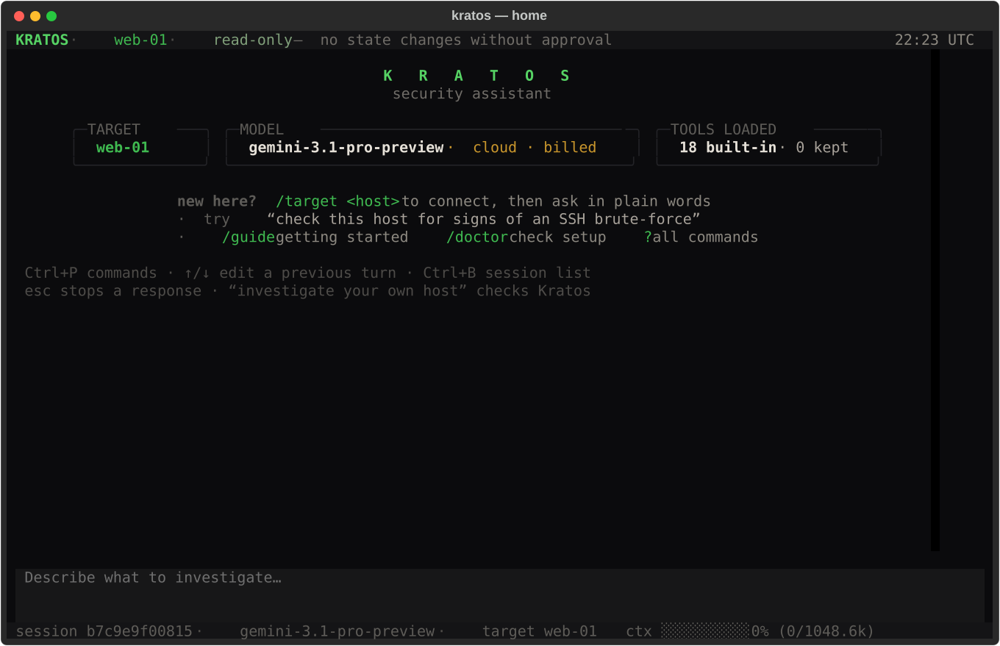
  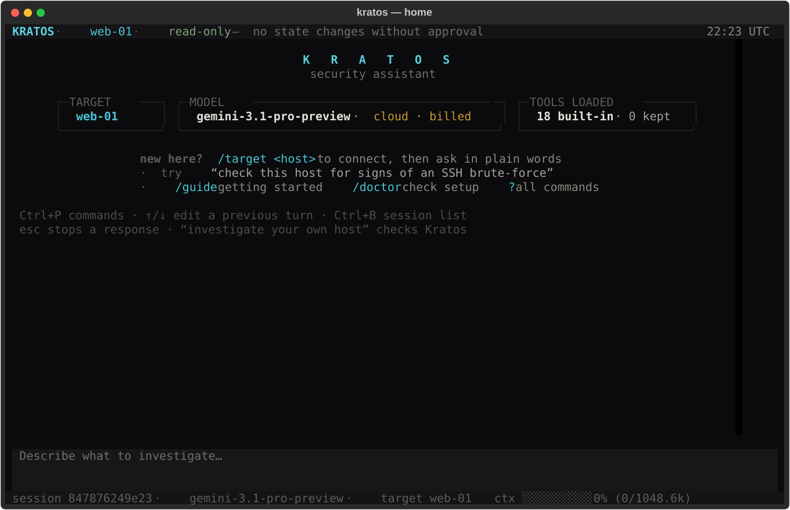
</p>

`/settings` also lets you manage models, decide which self-written tools need to
ask before running, and set your timezone.

---

## Running the evaluation (for contributors)

Kratos ships a regression gate that scores whether an investigation's **answer**
carries what Kratos found — the part most likely to drift when the prompt, the digest
or a model changes. It lives in `evals/` and runs as `kratos-eval` (from a checkout;
or `python -m evals`).

- `kratos-eval smoke` checks the gate's own machinery with a scripted model — no API
  key, no lab, a few seconds. It's what CI runs.
- `kratos-eval run --mode replay --scenarios A1,A8 -n 5` re-runs scenarios against
  **recorded** tool results (a real model, no machine needed), scoring each answer two
  ways: *person sees* (the whole answer) and *model alone* (the model's analysis with
  Kratos's own findings block removed).
- `kratos-eval gate --mode live` runs the scenarios against the lab with the real
  model and fails if the answers drop below the saved baseline (`evals/baselines/`).
  The lab setups themselves are kept outside the repository.

Any change to the system prompt, the digest, the model's tool list, or the shape of
an answer should be run through the gate before it lands.

---

## When something goes wrong

**"A sub-agent machine shows as not connected."** Open `/subagent` and select it
(`i`) — it says why it dropped. If Kratos says *"No Kratos listener is running"*,
open `/subagent` (which starts one) or install the always-on listener there (`l`).
If it says the listener *"can't serve investigation reads"*, it is still running
an older Kratos: the always-on service restarts itself onto the new version within
about a minute of being idle, or restart it now with the command shown.

**"It can't connect to the target."** Run `/doctor`. It will point at the exact
problem — the host is wrong, the SSH port is closed, the key isn't accepted, or a
required permission or helper program is missing on the target. Each failing line
comes with the fix. After fixing on the target, run `/target verify`.

**"The model isn't responding."** `/doctor` checks this too. Usually it's a wrong
address or key in `.env`, or (for a local model) the model server isn't running.
`/model` lets you switch to another one.

**"An investigation stopped with an error."** Kratos shows a plain message and
keeps your session — an error in one step never loses your work. Try rephrasing,
or run `/doctor` if it keeps happening.

**"A tool I built with /evolve keeps failing its test."** That's the safety net
working — a tool that can't pass its own test isn't kept. Kratos shows the exact
check that kept failing, with the values it saw, for example:

```
The check that kept failing: “The result must capture crontabs for non-root users —
assert 'www-data' in {'/var/spool/cron/crontabs/www-data': '...'}”
```

Here the test itself is wrong (the results are keyed by file path, so the key
`'www-data'` can never exist). Open the test file Kratos names, fix or delete that
check, and run `/evolve` again. If the check looks right, the idea may need to be
narrower. Nothing is saved until a tool passes and you approve it.

**"It's asking me something and I don't know what to pick."** For a question, the
recommended option (or just letting it decide with `Esc`) is a safe choice. For a
permission prompt, pressing Enter is always the safe "no."

---

## Words you'll see

- **Terminal** — the text window where you type commands (on Ubuntu: press
  `Ctrl+Alt+T`).
- **IP address** — a machine's number on the network, like `192.168.1.50`.
  `hostname -I` on a machine shows its own.
- **SSH** — the standard, encrypted way to log into another Linux machine. Kratos
  uses it to read a machine; an **SSH key** is a pair of files that lets it log in
  without a password.
- **API key** — a password-like string a model provider gives you so Kratos can use
  their model. Keep it secret.
- **`.env`** — Kratos's settings file. `kratos init` creates it and tells you where.
- **Target** — the machine Kratos is watching.
- **Placeholder** — what the model reads instead of a real name or address
  (`USER_1_k7qm`, `PUBLIC_IP_2_k7qm`); Kratos puts the real value back in the answer.
- **Finding** — a titled result Kratos reached, with evidence and a severity. Kratos
  remembers each one across checks, with a state (open, fixed, risk accepted, …).
- **Event** — one log line Kratos read, kept in `kratos.db` with its time, machine,
  user, IP and so on. `kratos events` shows them.
- **auditd** — Linux's audit system: when installed with rules, it records every
  program run, login and account change.
- **Sealed journal** — a journal the machine signs as it writes, so later edits can
  be detected. The *verification key* that checks the signatures stays with Kratos.
- **ATT&CK** — MITRE's public catalogue of attacker techniques; every finding about
  something an attacker did names the matching technique (`kratos attack-layer` draws
  the map).
- **Persistence** — the places an intruder leaves something behind to keep access
  across reboots and password changes (a cron job, a service, an SSH key, a setuid
  program, …). Kratos checks them by itself and reports what is new or backdoor-shaped.
- **Live response** — looking at what is *running right now* for signs of an active
  intrusion: a program that deleted its own file, code running from memory, a process
  started with an injected library, an executable dropped in /tmp, a shell under a web
  server. Kratos checks this by itself too and never kills anything.
- **CVE** — the public ID of one known vulnerability, like `CVE-2024-6387`.
- **KEV** — CISA's list of Known Exploited Vulnerabilities: CVEs attackers are using
  right now. A package with one is "act now".
- **EPSS** — a daily estimate of how likely a CVE is to be exploited in the next 30 days.
- **CVSS** — a 0–10 score of how bad a vulnerability is if exploited (7+ is serious).
- **Backport** — a distribution fixing a vulnerability in the version it ships, without
  changing the version number; why Kratos uses the distribution's own data.
- **Investigation** — one run where Kratos looks into a question.
- **Tool** — one specific check Kratos can run (read a log, scan ports, and so on).
- **Preset** — a saved investigation you can re-run.
- **Untrusted text** — anything that came from the machine you watch (usernames, file
  names, log lines). Kratos shows it as data only; see the section above.
- **Pipeline** — a fixed sequence of tools run in order, with no model steering.
- **Observe-only** — by default, Kratos reads and advises; it doesn't change the
  target itself. (The one exception is the experimental fix channel, off unless
  you turn it on for a machine.)
- **Sub-agent** — a small agent on a machine that connects out to Kratos, for
  machines Kratos can't reach over SSH.
- **Listener** — the part of Kratos that sub-agents connect to.
- **Allowlist** — the fixed set of actions a machine's sub-agent will accept, if
  the experimental fix channel is on for it.
- **Sandbox** — the locked-down space where a newly written tool is tested safely.
- **Approval / "requires approval"** — a yes/no gate before something with real
  consequences happens. A non-answer always means no.

---

For the design and the reasoning behind Kratos's choices, see
[DESIGN.md](DESIGN.md). For the short version of all this, type `/guide` inside
Kratos.
